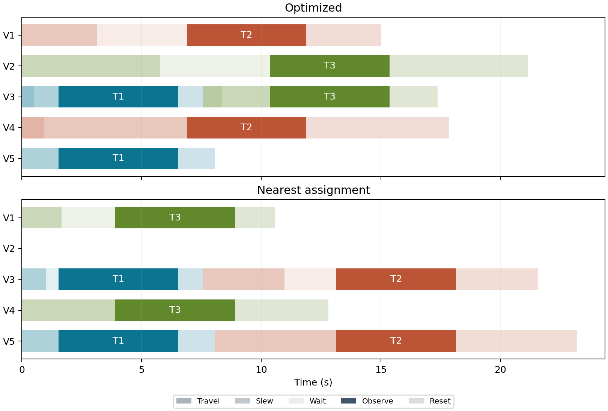
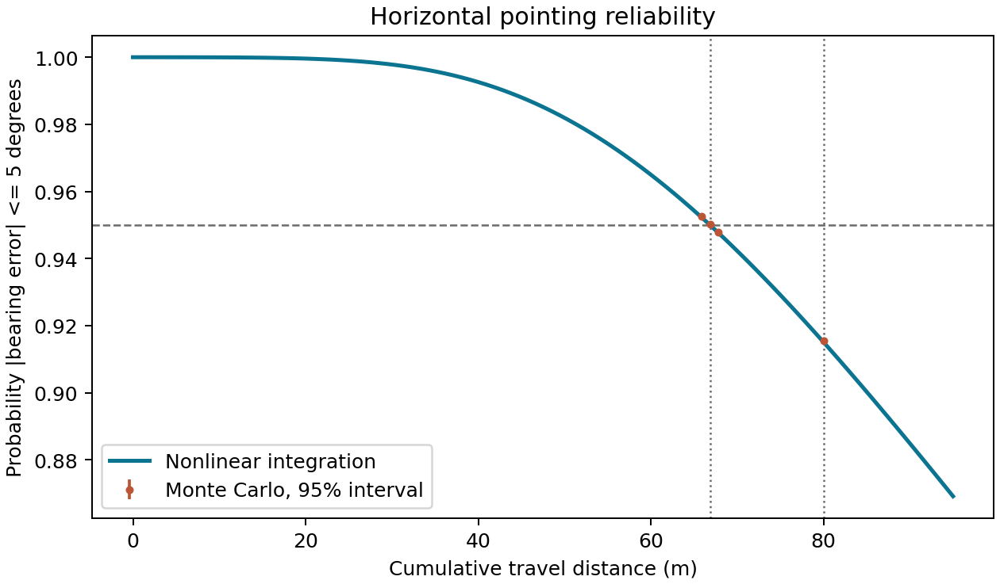

# 车载双站观测的几何建模、定位精度与动态调度

## 摘要

将车辆的几何可达性、光学可见性和云台时序统一到同一平面坐标系。第一问由最大仰角直接导出最小站距，第二问由水平方位交会的雅可比矩阵导出精度下界。多告警调度使用膨胀障碍可视图计算行驶时间，并将车辆指向、同步观测和回正纳入任务前后关系。第三问用投影正态分布和高斯云台误差卷积求概率约束。第四问将事件回放与滚动重调度结合，在同一扰动信息和时间窗口下对比策略。

第一问的 T1 最优站为 **(92.2231, 70.0000) m**，站距 **7.5821 m**。第二问的 T2 双站交会在 **$90^\circ$** 时达到全局最小一阶 RMSE **0.1436 m**。三告警方案在 **10.369 s** 内全部开始观测，比最近分配减少 **21.09%**，与连续下界相差 **0.121 s**。第三问得到 **66.84 m** 的里程上限，80 m 时要求 **$a+80b\le1.63675$ m**。第四问在所测 81 个扰动情景中，择优重调度均能在 60 s 内启动全部告警。

## 1. 问题分析与共同约定

告警 $(θ,R,H)$ 的水平投影为 $T=(50+R\cos θ,50+R\sin θ)$，真实观测点为 $(T_x,T_y,H)$。所有车辆和障碍位置取题面表 1 和初始位置。三个基准投影如下。

| 告警 | $T_x$（m） | $T_y$（m） | $H$（m） |
| --- | ---: | ---: | ---: |
| T1 | 84.6410 | 70.0000 | 45 |
| T2 | 11.0289 | 72.5000 | 35 |
| T3 | 59.8351 | 13.2948 | 55 |

| 符号 | 含义 |
| --- | --- |
| $P,Q$ | 车辆中心和候选观测站，两者的相机高度为 2 m |
| $r_i,\gamma,B$ | 第 $i$ 站到目标的水平距离、交会角和两站基线 |
| $d(P,Q)$ | 车辆中心沿安全路径行驶的长度 |
| $\alpha_j(P),e_j(P),g_j(P)$ | 在 $P$ 处观测目标 $j$ 的方位角、仰角与转动时间 |
| $S_j,A_{vj},F_v$ | 告警 $j$ 的同步观测开始、车辆 $v$ 的到达时刻、车辆可出发时刻 |
| $\sigma_\alpha,\sigma(s)$ | 方位测角噪声标准差、累计行驶 $s$ 后的单轴定位误差标准差 |

车辆按 3 m/s 行驶，移动时云台朝东且水平。方位按最短转向包裹到 $[-180^\circ,180^\circ)$，两个轴都可从 0 姿态同时转动，采用 $g_j(P)=\max(|\alpha_j(P)|,|e_j(P)|)/30$。发出观测任务后，两车各自到达并指向，准备先完成者等待。开始时刻为两车均准备完成的时刻或指定的更晚时刻。观测 5 s 后，各车独立回正，回正耗时与其名义转向耗时相同。零行驶时允许原地转向。路径约束采用题给边界和建筑；同步双站中心另设至少 3 m 间距以避免车体重叠，交会角在数值上离两个奇点至少 $0.01^\circ$。题给行驶避碰时间忽略，模型允许不同车辆的行驶轨迹交叉。

车辆相切建筑外缘时车体没有进入内部，允许相切。光学线段按闭集判定，触碰建筑也算遮挡。取建模阈值时使用未舍入的坐标。

## 2. 问题一 · T1 可观测区域和最佳单站

### 2.1 三类约束

设 $K_b=[x_b^-,x_b^+]\times[y_b^-,y_b^+]$ 为建筑底面，$h_b$ 为楼高。半径为 1.5 m 的车辆中心必须位于 $D=[1.5,98.5]^2$，并满足 $\operatorname{dist}(P,K_b)\ge1.5$。按坐标计算，$d_x=\max(x_b^--x,0,x-x_b^+)$，$d_y$ 同理，距离为 $\sqrt{d_x^2+d_y^2}$。这相当于从 $D$ 中删除各底面与半径 1.5 m 圆盘的闵可夫斯基和的内部。

把光线写成

$$
L(\lambda)=(P+\lambda(T-P),\ 2+\lambda(H-2)),\qquad 0\le\lambda\le1.
$$

与建筑 $b$ 的重叠可以分轴计算。对 $x,y$ 分别求使水平坐标落在闭区间的 $\lambda$ 区间，再与 $[0,\ell_b]$ 取交，其中 $\ell_b=\min(1,(h_b-2)/(H-2))$。两轴允许区间与这一高度区间有非空交集时，建筑遮挡视线。方向分量为零时，按起点坐标是否落在对应区间处理。闭区间的端点相遇仍判遮挡。

仰角 $e=\operatorname{atan2}(H-2,r)$，$r=\|P-T\|$。本题 $H>2$，所以 $-10^\circ$ 下限自动成立，$80^\circ$ 上限给出

$$
r\ge r_{\min}(H)=\frac{H-2}{\tan80^\circ}.
$$

可观测集合是车辆几何集合、无遮挡集合与仰角可行集合的交集。图中浅绿区域用细网格单元中心判定，图像分辨率与解析最优判定相互独立。

### 2.2 解析最优解

$$
P^\star\in\arg\max_{P\in\mathcal O_1}\frac1{\|P-T_1\|}.
$$

$Q$ 随 $r$ 严格递减，任何可行点都满足 $r\ge7.58206017$ m。圆 $r=r_{\min}$ 可行的点都达到同一最优值。并列时先选最大 $x$，再选最小 $y$，所以只需检验精确东侧点。该点中心及视线均在建筑以东，车辆离场地东界也有余量，故达到下界。结果为 **$(92.22307632,70.00000000)$ m**，水平距离 **7.58206017 m**，仰角 **$80^\circ$**，$Q^\star=0.13189027\ \mathrm{m}^{-1}$。采用 0.5、0.25 和 0.125 m 栅格估出的面积依次为 5608.000、5614.938、5607.938 m²，约 **$5.61\times10^3$ m²**。

## 3. 问题二 · 双站定位与车辆复用

### 3.1 双站交会的精度模型

给定两个站 $P_i$，观测方位 $\widehat\alpha_i=\alpha_i+\varepsilon_i$。令 $u(\phi)=(\cos\phi,\sin\phi)^\mathsf T$，用各自的方位直线求交。二维叉积形式为

$$
\widehat T=P_1+
\frac{(P_2-P_1)\times u(\widehat\alpha_2)}
     {u(\widehat\alpha_1)\times u(\widehat\alpha_2)}u(\widehat\alpha_1).
$$

在线性化中，$\alpha_i=\operatorname{atan2}(T_y-P_{iy},T_x-P_{ix})$ 对 $T$ 的导数是

$$
A_{i:}=\frac{(-\sin\alpha_i,\ \cos\alpha_i)}{r_i}.
$$

角噪声以弧度代入，$\sigma_\alpha=\pi/180$。两站独立且同方差，得到

$$
\delta T\approx A^{-1}\varepsilon,\qquad
\Sigma_T=\sigma_\alpha^2 (A^\mathsf T A)^{-1}.
$$

以一阶水平误差的平方均值根作为精度指标。它把 $x,y$ 误差合成米量纲标量，对坐标轴旋转不变。

$$
J=\sqrt{\operatorname{tr}\Sigma_T}
  =\sigma_\alpha\frac{\sqrt{r_1^2+r_2^2}}{|\sin\gamma|},
\qquad
B^2=r_1^2+r_2^2-2r_1r_2\cos\gamma.
$$

交会角由目标点看向两站的夹角计算，与两条指向目标的射线方向夹角等大。给定两条站距时，增加 $B$ 会改变交会角，$90^\circ$ 为最佳，继续增加到接近 $180^\circ$ 会导致病态。$\gamma\to0^\circ$ 或 $180^\circ$ 时矩阵秩趋于 1。实际使用时可在交会角上设置安全阈值，或按 $\det(A^\mathsf T A)$、条件数淘汰不稳定方案，并在多站情况下用最小二乘融合。观测区域边界本身不影响矩阵秩；如果贴着仰角上限或贴近遮挡，站位、目标或传感器有偏差时可见性容易丢失。需要裕量时可收紧 $e\le 80^\circ-\epsilon_e$ 并给视线留净空，再重新优化。

### 3.2 T2 全局最优站位

由 $r_1,r_2\ge r_{\min}(35)=5.81879036$ m 及 $|\sin\gamma|\le1$，

$$
J\ge \sqrt{2}\,\sigma_\alpha r_{\min}(35)=0.14362336\ \mathrm m.
$$

等号要求两站都取最小站距并正交。选 T2 西侧和北侧各一站，分别由 V1 和 V3 以直线路径驶入。

| 车辆 | 站位 $(x,y)$（m） | 站距（m） | 仰角 | 行驶时间（s） |
| --- | --- | ---: | ---: | ---: |
| V1 | (5.21006647, 72.50000000) | 5.81879036 | $80^\circ$ | 19.77117 |
| V3 | (11.02885683, 78.31879036) | 5.81879036 | $80^\circ$ | 2.74527 |

站位和直线路径均满足车体几何条件，视线进入 B3 水平投影时已高过楼顶，且两车行驶均未超过 30 s。基线 **8.22901225 m**，交会角 **$90^\circ$**，从而实际取得最小 $J$。$\Sigma_T$ 近似 $0.01031383 I_2\ \mathrm m^2$。30 万组独立方位噪声做非线性交会，剔除离奇异方向不足 $10^\circ$ 的样本，实际剔除 0 组。样本条件 RMSE 为 0.14365 m，95% 径向误差分位数为 0.24839 m。正态角噪声在理论上可产生极少量接近平行的直线，分母正弦趋零会破坏无截断的全局二阶矩，因此将 $J$ 解释为局部名义精度，仿真用于校验良态下的一阶近似。

### 3.3 安全行驶、调度目标与算法

以精确车体膨胀障碍的外切多边形近似行驶障碍。每个 $90^\circ$ 圆角由 4 段角间隔的切线构造，最大外凸量为 $1.5[\sec(11.25^\circ)-1]\approx0.0294$ m。把障碍顶点、路程端点加入可视图，任意连线若不穿过膨胀障碍的内部即为边，边权为线段长度。障碍顶点对用 Floyd–Warshall 求最短路，查询端点时用直连或经障碍顶点的最短组合。所得路径对原圆盘几何可行，代码还逐段复核实际圆盘到建筑的距离。

若车辆 $v$ 在 $F_v$ 时可出发，届时位置为 $p_v$，派到告警 $j$ 的站位 $p_{vj}$ 时

$$
A_{vj}=F_v+\frac{d(p_v,p_{vj})}{3},\qquad
S_j\ge \max_{v\in U_j}\{A_{vj}+g_j(p_{vj})\}.
$$

$U_j$ 恰有两辆不同车辆。观测结束时刻是 $S_j+5$，参与车辆的可用时刻更新为 $F_v=S_j+5+g_j(p_{vj})$，位置更新为 $p_{vj}$。同一辆车两次观测之间必须完成以上全部动作。求解目标为 $\min\max_{j\in\{1,2,3\}} S_j$。第二问第一部分的 30 s 行驶限时仅用于其双站算例。这里按本小问题目标计时，站位可来自整个可观测区域。

候选池含安全区域格点、初始车辆位置以及靠近仰角约束边界的环形采样。对可观测站预计算最短路、指向时间和双站兼容性。计算分两路。

1. **枚举单车复用的离散子问题。** 枚举复用车 $i$、它的前后告警 $j\to k$、各自的专用搭档 $u,v$；第三个告警由剩下两车负责，可以并行。对给定第一个站 $p$，只需选兼容且准备最早的搭档站，得到 $S_j(p)$。对第二个站 $q$，复用车准备最早为 $\min_p[S_j(p)+5+g_j(p)+d(p,q)/3+g_k(q)]$，再与第二个搭档最早的兼容站比较。第三个告警独立计算。这个最小化对指定候选集和恰有一辆车复用的结构穷尽。
2. **搜索一般复用结构。** 状态含已安排告警集合、各车辆末站和可出发时刻。逐个加入尚未安排的告警，枚举车辆对，从准备较快的站位短名单中生成兼容组合。每个告警子集仅保留按下界排序的前若干状态，下界取当前最大开始时刻与剩余告警单独最早时刻之最大值。该剪枝允许多个车辆复用结构，最后固定任务顺序和分工，在连续平面上作逐站邻域搜索，所有新站重新验可行性。

“最近分配”基线使用同一候选点、行驶路径、可观测性及同步约束。每轮在剩余告警和所有车辆对中选择两车**总行驶距离最小**的组合，等距时选择开始较早者，再按告警编号择优。它在评分中使用距离，准备和回正按同一时序真实计入。

**优化方案。** V3 执行 T1 后回正，再转移至 T3 的站点。其余四车分担三个告警的其余四个站位。表中时间单位为秒，指向区间从到站延续至准备完毕，回正区间从观测结束延续至再次可用。

| 车辆 | 告警 | 站位 $(x,y)$（m） | 出发 | 到站 | 指向完成 | 观测开始 | 观测结束 | 回正完成 |
| --- | --- | --- | ---: | ---: | ---: | ---: | ---: | ---: |
| V3 | T1 | (14.989949, 87.131371) | 0.0000 | 0.5011 | 1.5325 | 1.5325 | 6.5325 | 7.5639 |
| V5 | T1 | (50.000000, 93.000000) | 0.0000 | 0.0000 | 1.5320 | 1.5325 | 6.5325 | 8.0646 |
| V1 | T2 | (15.000000, 14.000000) | 0.0000 | 0.0000 | 3.1294 | 6.8923 | 11.8923 | 15.0218 |
| V4 | T2 | (87.993223, 70.803223) | 0.0000 | 0.9344 | 6.8923 | 6.8923 | 11.8923 | 17.8502 |
| V2 | T3 | (88.001112, 10.001112) | 0.0000 | 0.0005 | 5.7782 | 10.3688 | 15.3688 | 21.1465 |
| V3 | T3 | (16.671751, 88.828249) | 7.5639 | 8.3603 | 10.3688 | 10.3688 | 15.3688 | 17.3773 |

表中坐标为四舍五入展示值，精确站位和路线见 [结果汇总](results/summary.json) 与 [第二问逐车时间轴](results/q2_vehicle_timelines.csv)。V3 第一次回正完成于 7.56394 s，随后立即转场。其第二站接近 B3 光学遮挡边界，部署时可施加视线净空约束并重新计算。

**最近分配方案。** 最近法优先选原地可观测站，V2 闲置，V3、V5 都参与 T1 和 T2。

| 告警 | 车辆及站位（m） | 开始（s） | 结束（s） |
| --- | --- | ---: | ---: |
| T1 | V3 (14, 86)、V5 (50, 93) | 1.5320 | 6.5320 |
| T3 | V1 (15, 14)、V4 (88, 68) | 3.9081 | 8.9081 |
| T2 | V3 (14, 86)、V5 (50, 93) | 13.1392 | 18.1392 |

最近法各车行驶距离为零，V5 完成 T1 并回正后，再用 5.07514 s 转向 T2，限制了最终开始时刻。优化方案在 T1 进行期间并行准备 T2 和 T3，并以 V3 的 T1→T3 缩短串行复用链。总行驶由 0 增为约 6.70 m，最晚开始提前 **2.7704 s**，降幅 **21.09%**。

### 3.4 连续下界和数值精度

任何完整解占用六个车辆任务槽，至少一辆车 $i$ 必须连续执行有序告警对 $j\to k$。对第一站和第二站，划分覆盖中心可行域的方格 $C,D$。点到格和格到格的最小欧氏距离给出行驶时间下界。以格到目标的最大距离界定最小仰角，用包含方格的外接圆所张角度界定最小横转角，两者取最大再除以 30，记为格内指向下界 $\underline g_j(C)$。整格若位于车体禁入区或存在同一高度比例 $\lambda$ 使整格的光线均触及同一楼体，则删去该格。

设其他车辆单独为 $j$ 准备的最早下界为 $\underline b_{-i,j}$。对任一链，其结束任务的观测开始时刻至少为

$$
\max\!\left\{\frac{\operatorname{dist}(P_i^0,C)}3+\underline g_j(C),\underline b_{-i,j}\right\}
+5+\underline g_j(C)+\frac{\operatorname{dist}(C,D)}3+\underline g_k(D).
$$

用所有格对、复用车和有序告警对取最小值，得到全问题的连续下界。式中放宽了绕障行驶和两站匹配，且忽略复用链外的任务，因此最小化所得的值是原问题的下界。

利用可行上界剪除无法改善上界的格对。1、0.5、0.25、0.125 m 方格依次得到 9.55312、10.01361、10.12881 和 **10.24771 s** 的下界。连续任务目标的下确界位于 **[10.24771, 10.36879] s**，上下界相差 **0.12108 s**，约为下界的 1.18%。最晚开始时刻对候选站分辨率的敏感性如下。

| 候选格距（m） | 站点数 | 束搜索（s） | 单车复用离散最优（s） | 连续细化（s） |
| ---: | ---: | ---: | ---: | ---: |
| 5 | 507 | 10.8296 | 10.8296 | 10.8296 |
| 3 | 1141 | 10.8296 | 10.8296 | 10.8296 |
| 2 | 2425 | 10.6536 | 10.5674 | 10.3688 |

方格下界覆盖连续站位和任意车辆复用。可行区域中的光学遮挡边界按开边界处理，因此用上下界区间度量当前可行解与连续最优值的差距。

## 4. 问题三 · 方位误差传播和累计里程约束

### 4.1 精确概率模型

二维定位误差各向同性，可把真车位置平移到原点并旋转坐标使理想目标在 $(40,0)$。让 $Z_x,Z_y$ 独立标准正态，$E_0,E_c$ 分别为以度计的 $N(0,0.8^2)$ 和 $N(0,0.6^2)$，则有效指向偏差为

$$
\Delta\psi=\operatorname{wrap}\left[
\frac{180}{\pi}\operatorname{atan2}\bigl(-\sigma Z_y,40-\sigma Z_x\bigr)+E_0+E_c
\right].
$$

第一项为根据估计位置计算的指令相对真方位的几何偏差，后两项为实际执行的附加偏差。定义 $m=40/\sigma$、弧度角 $\beta$ 和标准正态密度 $\varphi$、分布函数 $\Phi$。将均值 $(m,0)$、单位协方差的二维正态改写为极坐标，对半径 $\rho$ 积分，得到

$$
f_\beta(\beta)=
\varphi(m\sin\beta)\big[\varphi(m\cos\beta)+m\cos\beta\,\Phi(m\cos\beta)\big],\quad -\pi\le\beta<\pi.
$$

令 $w=5\pi/180$，$\tau=\pi/180$（两云台误差的合成标准差为 $1^\circ$），则成功概率为

$$
p(\sigma)=\int_{-\pi}^{\pi} f_\beta(\beta)
\sum_{n\in\mathbb Z}\left[
\Phi\!\left(\frac{w+2n\pi-\beta}{\tau}\right)
-\Phi\!\left(\frac{-w+2n\pi-\beta}{\tau}\right)\right] d\beta.
$$

程序保留 $n=-1,0,1$，其余项距积分区间至少 500 个标准差，双精度下可忽略。对固定 $Z_x,Z_y$，由向量 $(40,0)-\sigma(Z_x,Z_y)$ 的方向可知 $\partial|\beta|/\partial\sigma=40|Z_y|/\|(40,0)-\sigma(Z_x,Z_y)\|^2\ge 0$（几乎处处）。包裹正态密度在距零方向的绝对圆周角上递减，对称窗口条件概率也递减，因此 $p(\sigma)$ 随 $\sigma$ 增大而下降。用一维自适应积分和括区间求根解 $p(\sigma)=0.95$。

### 4.2 里程上限、80 m 约束和验证

**$\sigma_\star=1.63674517$ m，$s_{\max}=(\sigma_\star-0.3)/0.02=66.83726$ m。** 原模型在 80 m 时 $\sigma=1.9$ m，成功概率约 **91.5068%**。

要求车辆行驶 80 m 后仍有 95% 成功概率时，可行域是

$$
\boxed{\,a\ge0,\qquad b\ge0,\qquad a+80b\le 1.63674517\ \mathrm m\,}.
$$

$a$ 的单位为 m，$b$ 的单位为 m/m。保持 $a=0.3$ m 时 $b\le0.01670931$。保持 $b=0.02$ 时 $a\le0.03674517$ m。

一阶展开给出 $\Delta\psi\approx -(180/\pi)\sigma Z_y/40+E_0+E_c$。用正态分位数 1.959964 解得近似里程上限 66.92230 m，比精确积分高 0.08504 m。当 $\sigma/40\approx0.041$ 时近似合理，但最终阈值使用非线性模型。600,000 次固定种子仿真用于检验。

| 距离（m） | 非线性积分概率 | 仿真概率 |
| ---: | ---: | ---: |
| 65.8373 | 0.952346 | 0.952575 |
| 66.8373 | 0.950000 | 0.950175 |
| 67.8373 | 0.947605 | 0.947828 |
| 80.0000 | 0.915068 | 0.915538 |

临界点蒙特卡洛的 95% Wilson 区间为 $[0.949622,0.950723]$。在临界里程的一阶方差中，定位、零偏、控制误差依次占 **84.61%、9.85%、5.54%**。定位的横向分量直接影响方位，径向分量主要通过分母产生高阶影响。短距离时定位误差较小，云台占比更高；接近里程上限时，应优先控制定位误差随路程增长的斜率，或在长里程任务间校正车辆位置。

## 5. 问题四 · 扰动回放、重调度和策略比较

### 5.1 事件触发和状态更新

$t=0$ 只用当时已知的三个告警制定并执行第二问方案。若发生故障，失效车辆从 $t=5$ 立即退出且不作为障碍。已经开始的观测计为成功，即使其中一车随后故障。无断联时在 $t=5$ 下发调整，有断联时在 $t_{\rm rec}$ 下发。恢复前车辆按原指令行驶、指向、等待或执行能完成的同步观测。某同步任务因故障无法开始时，其伙伴继续完成已收到的行驶和指向动作，随后等待新指令；依赖该任务完成才能出发的后续任务被阻塞。无通信期间实际已开始的观测同样锁定，避免恢复时回改历史。

重调度从截止时刻的实际位置和姿态开始。途中车辆按已行驶长度在折线路径上插值。已开始观测的幸存车辆参加完 5 s 观测并回正，之后可再次分配。未开始观测的在途或在站车辆可被撤回，若云台已转动，则自当前角度按速度上限回正后再开车。特定任务若继续执行，保留已完成的路程和指向。算法在每个事件之后只调整尚未开始的任务，在当前释放时刻上求

$$
\max_{\rm lex}\ (k,-t_{\rm last}),\qquad
\eta=k/N,\qquad
t_{\rm last}=\begin{cases}\max_j S_j,& k=N,\\60,& k<N.\end{cases}
$$

判定窗口为 $[0,60]$ s，成功以双车均已指向且开始同步观测为准，5 s 的观测可以延续到窗口外。未完成方案之间如果 $k$ 相同，内部搜索可优先保留已成功告警较早的计划作为并列选择。最终策略比较严格遵循题面的二元指标。

### 5.2 情景和对照策略

单独新增覆盖四个正方向的 $R=30,50$ m，再以四个对角方向的 $R=40$ m 补充角度覆盖，共 12 个目标。两类或三类扰动组合时用东西两个 $R=50$ m 目标代表场地两端的区别；失效车辆始终遍历 V1–V5 且等权。恢复时刻取 10、20、30 s，覆盖恢复较早、中间和最晚的节点，持续时长 5、15、25 s 同时兼容题面的恢复时刻上限和持续时间描述。样本统计按组合内均匀汇总，关于新增方向、半径或恢复时刻的结论限于所取情景。共 81 个扰动情景和 1 个无扰动对照。

| 输出策略 | 执行规则 |
| --- | --- |
| `retain` | 保留原方案各任务的车对和原站位，恢复后取消因失效而无法执行的原任务。新增告警继续计入 $N$ |
| `retain_plus` | 原派单同上，恢复后允许幸存车辆在各自固定原队列之后接新增告警。这给出更强的对照 |
| `replan_raw` | 从实际状态撤回未开观测的派单，以车辆对与站位的束搜索重新安排所有待办任务 |
| `replan` | 比较继续原队列并追加与重新优化两条可行计划。按 $(\eta,t_{\rm last})$ 择优，并列保留原队列 |

### 5.3 结果

下表各格为该组情景的 $(\bar\eta,\bar t_{\rm last})$，时间单位为秒。$\bar t_{\rm last}$ 包含未完成时的 60 s 罚值。

| 扰动组 | 情景数 | 严格保持原方案 | 保持原方案并追加 | 择优重调度 |
| --- | ---: | --- | --- | --- |
| 仅新增 | 12 | (75.00%, 60.00) | (100.00%, 17.77) | (100.00%, 17.77) |
| 仅故障 | 5 | (73.33%, 50.07) | (73.33%, 50.07) | (100.00%, 14.13) |
| 仅断联 | 3 | (100.00%, 10.37) | (100.00%, 10.37) | (100.00%, 10.37) |
| 新增 + 故障 | 10 | (55.00%, 60.00) | (80.00%, 51.99) | (100.00%, 22.69) |
| 新增 + 断联 | 6 | (75.00%, 60.00) | (100.00%, 24.81) | (100.00%, 24.80) |
| 故障 + 断联 | 15 | (73.33%, 50.07) | (73.33%, 50.07) | (100.00%, 22.39) |
| 三类同时 | 30 | (55.00%, 60.00) | (80.00%, 53.06) | (100.00%, 28.69) |

各类扰动的代表情景如下，可按编号查看逐车时间轴。

| 情景 | 编号 | 严格保持 | 继续并追加 | 总是撤回重排 | 择优重调度 |
| --- | --- | --- | --- | --- | --- |
| 新增，东侧 50 m | `N000_50` | (75.00%, 60.00) | (100.00%, 18.30) | (100.00%, 20.62) | (100.00%, 18.30) |
| V2 故障 | `V2` | (66.67%, 60.00) | (66.67%, 60.00) | (100.00%, 12.94) | (100.00%, 12.94) |
| 断联，10 s 恢复 | `R10` | (100.00%, 10.37) | (100.00%, 10.37) | (100.00%, 13.65) | (100.00%, 10.37) |
| 东侧 50 m + V4 故障 | `N000_50_V4` | (50.00%, 60.00) | (75.00%, 60.00) | (100.00%, 21.05) | (100.00%, 21.05) |
| 西侧 50 m + 30 s 恢复 | `N180_50_R30` | (75.00%, 60.00) | (100.00%, 33.77) | (100.00%, 33.77) | (100.00%, 33.77) |
| V5 故障 + 30 s 恢复 | `V5_R30` | (100.00%, 10.37) | (100.00%, 10.37) | (100.00%, 10.37) | (100.00%, 10.37) |
| 西侧 50 m + V5 故障 + 30 s 恢复 | `N180_50_V5_R30` | (75.00%, 60.00) | (100.00%, 33.77) | (100.00%, 33.77) | (100.00%, 33.77) |

- **原任务失去一个观测站时，重排有价值。** 仅 V2 故障时，原日程无法启动 T3。用幸存车重组站对后，三个告警在 12.94 s 前全部开始。四个会影响后续任务的单车故障情景均由重排补齐。三类扰动同时发生时，继续并追加的平均完成率为 80%，择优重调度提高到 100%，平均罚后最晚开始从 53.06 s 降到 28.69 s。
- **原派单仍有效时，保留进度更快。** 仅新增东侧 50 m 告警时，追加方案能在 18.30 s 全部启动。撤回已在准备 T2、T3 的车辆会丢掉行驶或指向进度，最晚时刻延到 20.62 s。仅断联到 10 s 时，V3 已接近 T3 指向完成，继续原派单在 10.37 s 开始最后一项，全部撤回重排则要 13.65 s。
- **新指令受恢复时刻约束。** 西侧 50 m 新告警、V5 故障且 30 s 恢复时，V5 参加的 T1 已从 1.53 s 开始，剩余原告警照常启动，新增告警于恢复后派单，最终开始为 33.77 s。所测场景下择优重调度的最晚时刻最高为 41.92 s，对应西侧 50 m 新告警、V1 故障且 30 s 恢复。

所有情景的逐车时间轴见 [第四问车辆事件表](results/q4_vehicle_timelines.csv)。同一行记录相位的起止时刻、位置、转角和路径折点。按 `scenario`、`policy`、`vehicle` 过滤即可还原每辆车的出发、到达、云台转向、同步等待、观测、回正和再次出发。观测开始/结束是 `observe` 行的起/止时刻。各警报开始时刻和最终指标在 [逐场景指标表](results/q4_scenarios.csv)。

## 6. 模型检验与使用边界

- **解析检验**。第一问最小边界站距和第二问的 RMSE 下界均给出能取等号的可行点。第二问对模型使用了非线性交会模拟，第三问用积分、一阶公式和随机仿真交叉检验。
- **几何与时序检验**。程序检查每段行驶与圆盘安全距离、固定车速、相邻动作的位置和姿态连续、单车无时间重叠、成对站位可观测、车辆同时开始观测且云台指向正确。故障车辆的事件在其退出时刻截断。
- **优化保证**。多任务调度中给出连续下界和可行上界。单车复用枚举的最优性限于候选站集合与相应分工，连续搜索和扰动束搜索只能给出已找到的可行策略。第四问情景均值描述本离散情景集。
- **场景边界**。目标在部署阶段静止，路径代价忽略转弯、启停和车间避碰时间。强度不同的角度裕量、观测站动态迁移或移动目标会改变可行集合和结果；上述数值保持题面名义参数。

## 参考材料

1. 2026 年第十二届数维杯全国大学生数学建模挑战赛（秋季赛）B 题。题面第 1–5 页提供几何、时序及评价定义。
2. 《2026 第十二届数维杯全国大学生数学建模挑战赛（秋季赛）参赛白皮书》。参考 PDF 第 131–135 页的 2025 年 B 题优秀论文和第 438–439 页的 2024 年 B 题优秀论文，组织为“摘要—问题分析—假设与符号—逐问建模及验证—评价”，推导、算法与数值由本题重新建立。
