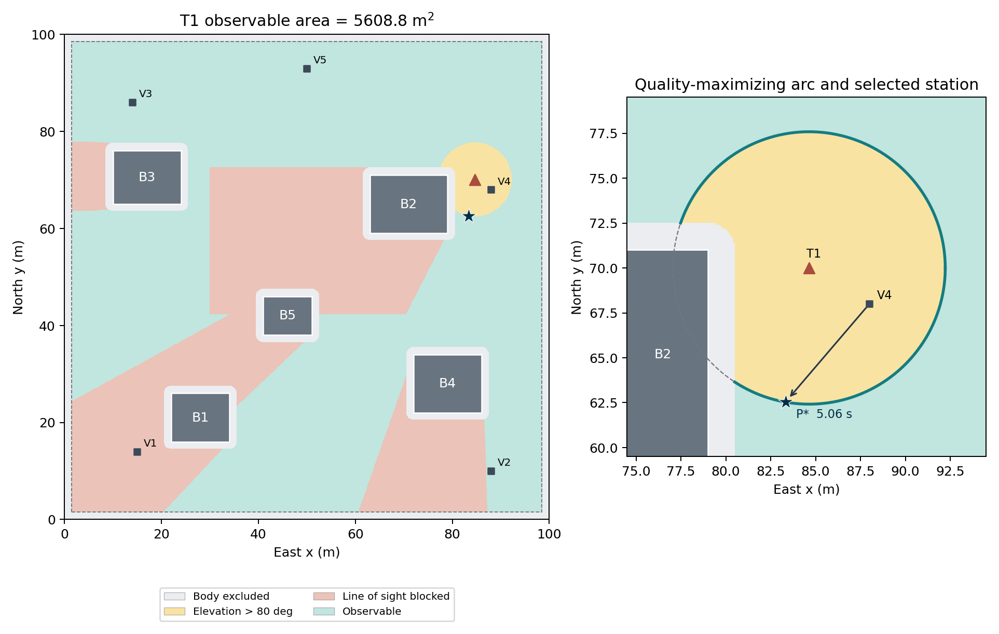
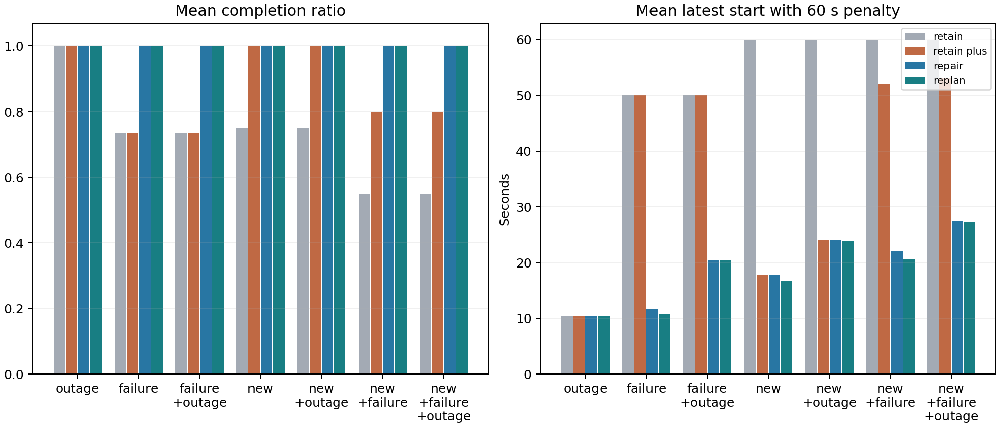

# 车载双站观测的几何建模、定位精度与动态调度

## 摘要

将车辆的几何可达性、光学可见性和云台时序统一到同一平面坐标系。第一问由最大仰角直接导出最小站距，第二问由水平方位交会的雅可比矩阵导出精度下界。多告警调度使用膨胀障碍可视图计算行驶时间，并将车辆指向、同步观测和回正纳入任务前后关系。第三问用投影正态分布和高斯云台误差卷积求概率约束。第四问将事件回放与滚动重调度结合，在同一扰动信息和时间窗口下对比策略。

第一问的 T1 可观测面积为 **5608.77 m²**。等质量最优站的站距为 **7.5821 m**，按准备时间择优后由 V4 在 **5.065 s** 抵达并指向 **(83.3244, 62.5331) m**。第二问的 T2 达到全局最小一阶 DRMS **0.1436 m**，V5 与 V3 在 **16.8741 s** 同步就绪。题面三告警方案在 **10.362 s** 内全部开始观测，比最近分配减少 **21.14%**，与连续下界相差 **0.114 s**；附加 0.50 m 精度门槛的对照方案用时 **25.002 s**。第三问得到 **66.84 m** 的里程上限，80 m 时要求 **$a+80b\le1.63675$ m**。第四问用题面调度检验 **419 个扰动情景**；自适应重调度在这些情景中均启动全部告警。30 s 恢复的配对压力测试中，题面和精度模型分别有 **40/40** 与 **27/40** 个情景全部启动。

## 1. 问题分析与共同约定

告警 $(θ,R,H)$ 的水平投影为 $T=(50+R\cos θ,50+R\sin θ)$，真实观测点为 $(T_x,T_y,H)$。所有车辆和障碍位置取题面表 1 和初始位置。三个基准投影如下。

| 告警 | $T_x$（m） | $T_y$（m） | $H$（m） |
| --- | ---: | ---: | ---: |
| T1 | 84.6410 | 70.0000 | 45 |
| T2 | 11.0289 | 72.5000 | 35 |
| T3 | 59.8351 | 13.2948 | 55 |

| 符号 | 含义 |
| --- | --- |
| $P,Q$ | 车辆中心和候选观测站，两者的相机高度为 2 m |
| $r_i,\gamma,B$ | 第 $i$ 站到目标的水平距离、交会角和两站基线 |
| $d(P,Q)$ | 车辆中心沿安全路径行驶的长度 |
| $\alpha_j(P),e_j(P),g_j(P)$ | 在 $P$ 处观测目标 $j$ 的方位角、仰角与转动时间 |
| $S_j,A_{vj},F_v$ | 告警 $j$ 的同步观测开始、车辆 $v$ 的到达时刻、车辆可出发时刻 |
| $\sigma_\alpha,\sigma(s)$ | 方位测角噪声标准差、累计行驶 $s$ 后的单轴定位误差标准差 |

车辆按 3 m/s 行驶，移动时云台朝东且水平。方位按最短转向包裹到 $[-180^\circ,180^\circ)$，两个轴都可从 0 姿态同时转动，采用 $g_j(P)=\max(|\alpha_j(P)|,|e_j(P)|)/30$。两车各自到达并指向，较早就绪者等待搭档；双车都就绪时启动观测。观测 5 s 后，各车独立回正，耗时与其由正东水平姿态转至目标的时长相同。零行驶时允许原地转向。路径约束采用题给边界和建筑；同一告警的站对中心另设至少 3 m 间距以避免车体重叠，交会角在数值上离两个奇点至少 $0.01^\circ$。题给行驶避碰时间忽略，模型允许不同车辆的行驶轨迹交叉。

车辆相切建筑外缘时车体没有进入内部，允许相切。光学线段按闭集判定，触碰建筑也算遮挡。取建模阈值时使用未舍入的坐标。

## 2. 问题一 · T1 可观测区域和最佳单站

### 2.1 可观测集合与建筑阴影

记 $T=(84.64101615,70)$ 为 T1 的水平投影，$H=45$ m，车辆半径 $\rho=1.5$ m，相机高度 $h_c=2$ m。设 $K_b=[x_b^-,x_b^+]\times[y_b^-,y_b^+]$ 为建筑 $b$ 的底面，$h_b$ 为楼高。车辆中心必须位于 $D=[\rho,100-\rho]^2$，且 $\operatorname{dist}(P,K_b)\ge\rho$。等价地，从 $D$ 中去除各圆角膨胀矩形 $\widetilde K_b=K_b\oplus\mathbb B_\rho$ 的内部。仰角 $e=\operatorname{atan2}(H-h_c,r)$，其中 $r=\lVert P-T\rVert$。由于目标高于相机，仰角下限自动满足，上限等价于

$$
r\ge r_0=\frac{H-h_c}{\tan80^\circ}=7.58206017\ \mathrm m.
$$

相机到目标的视线取为 $L(\lambda)=(P+\lambda(T-P),h_c+\lambda(H-h_c))$，其中 $0\le\lambda\le1$。对建筑 $b$，只有 $\lambda\le\ell_b=(h_b-h_c)/(H-h_c)$ 的视线低于或触及楼顶。代码通过分轴裁剪，把对应水平线段与闭矩形 $K_b$ 求交，因此能识别触边的遮挡。

为了计算连续区域面积，把线段判定反解为站点集合。设 $q$ 是视线在建筑底面中的投影交点，则 $P=T+(q-T)/(1-\lambda)$。令 $s_b=(1-\ell_b)^{-1}$。所有遮挡站点由 $q\in K_b$ 和 $1\le s\le s_b$ 生成。由于 $K_b$ 为凸集，这些以 $T$ 为中心的缩放矩形的并集，等于两个端点矩形的凸包

$$
S_b=\operatorname{conv}\bigl(K_b\cup [T+s_b(K_b-T)]\bigr).
$$

因此 $\mathcal O_1$ 是 $D$ 扣除车体禁入区域、开圆盘 $\{P:\lVert P-T\rVert<r_0\}$ 和五个闭阴影多边形的集合。五车初始位置中，V2、V3、V5 可原地看见 T1。V1 受 B5 遮挡，V4 因水平距离过近而超过仰角上限。

### 2.2 连续面积与栅格复核

对每个横坐标 $x$，车体膨胀障碍、仰角禁入圆盘和建筑阴影与竖线分别相交成若干纵向区间。圆角障碍的截面可直接计算，例如建筑底面到 $x$ 的横向距离为 $d_x\le\rho$ 时，纵向区间为 $[y_b^--\sqrt{\rho^2-d_x^2},\,y_b^++\sqrt{\rho^2-d_x^2}]$。依次合并车体、仰角和遮挡区间，每一步按与上一阶段的差值统计独占损失，再对剩余截面长度做一维自适应积分。这样能正确处理不同阴影之间以及阴影与前两类禁区之间的重叠。

| 方法 | 车体可停靠面积（m²） | 仰角额外损失（m²） | 遮挡额外损失（m²） | 最终可观测面积（m²） |
| --- | ---: | ---: | ---: | ---: |
| 连续截面积分 | 8302.6571 | 157.4395 | 2536.4470 | **5608.7706** |
| 0.10 m 栅格 | 8302.2000 | 157.4500 | 2534.3500 | 5610.4000 |
| 0.05 m 栅格 | 8302.6500 | 157.4325 | 2536.6900 | 5608.5275 |

五栋膨胀建筑彼此分离且完全落在 $D$ 内，可停车体面积的独立闭式校验为 $(100-2\rho)^2-\sum_b[w_b d_b+2\rho(w_b+d_b)+\pi\rho^2]$，其中 $w_b,d_b$ 是建筑的底面边长。计算得 8302.6571 m²，与积分结果一致。参考论文第 4.1 节的 5610.4 m² 是 0.10 m 栅格统计，本程序以相同步长复现该结果，并采用连续区域的积分值作为主结果。

### 2.3 所有等质量最优位置

对 $\mathcal O_1$ 中的点最大化 $Q=1/r$，等价于最小化 $r$。任何可行点都有 $r\ge r_0$，圆 $r=r_0$ 上的可观测站点均取等号。令 $P(\phi)=T+r_0(\cos\phi,\sin\phi)$，$\phi$ 从 x 轴正向逆时针计。程序求该圆与场界、膨胀建筑的直边和圆角以及阴影多边形边界的交角，以交角划分角域，分别检查子区间内点与端点。

得到最优弧 $\phi\in[236.89605^\circ,360^\circ]\cup[0^\circ,160.74787^\circ]$。两个端点分别落在 B2 的东侧中心限位 $x=80.5$ 和北侧中心限位 $y=72.5$，车辆相切且视线通过闭区间检验。弧张角共 **283.85183°**，弧长 **37.56266 m**。弧上均有 $r^\star=7.58206017$ m、$e^\star=80^\circ$、$Q^\star=0.13189027\ \mathrm{m}^{-1}$。

### 2.4 并列规则与最早准备时间证明

先最大化观测质量，再在所有等质量站位和五辆车中，最小化警报发出至车辆到站并完成云台指向的时间

$$
t_i(P)=\frac{d(P_i^0,P)}{3}+\frac{\max\{|\alpha(P)|,80^\circ\}}{30^\circ/\mathrm s},
\qquad P\text{ 位于最优弧}.
$$

若 $D_i=\lVert P_i^0-T\rVert$，三角不等式给出任意最优站的准备时间下界 $|D_i-r_0|/3+80/30$。V1、V2、V3、V5 的下界分别为 29.927、20.171、24.283、14.000 s，均晚于 V4 可实现的 5.065 s。

对 V4 先允许沿整圆选站并将行驶距离放宽为欧氏距离。记它的初始方向为 $\phi_0=329.22966^\circ$、初始站距为 $D_4\approx3.909$ m。把两点同时旋转 $-\phi$ 后，可将欧氏距离写为 $\lVert(r_0,0)-D_4(\cos(\phi_0-\phi),\sin(\phi_0-\phi))\rVert$。因此弧度角每变化 1 rad，行驶时间的变化率绝对值至多 $D_4/3\approx1.303$ s/rad。横转主导区间的指向时间斜率绝对值为 $180/(30\pi)\approx1.910$ s/rad，所以总时间在 $[0^\circ,100^\circ]$ 递减，在 $[260^\circ,360^\circ]$ 递增。中间区间的指向时间恒为 $80/30$ s，V4 的最近方向在区间外，故比较 $100^\circ$ 和 $260^\circ$ 即可，后者更快。

$\phi=260^\circ$ 位于最优弧，V4 至该点的直线行驶满足车体净空。因此放宽问题的最小值在原问题中可达到，所得站位是上述两级准则下的全局解。

| 车辆 | 站位 $(x,y)$（m） | 行驶距离（m） | 行驶时间（s） | 指向时间（s） | 准备完毕（s） |
| --- | --- | ---: | ---: | ---: | ---: |
| **V4** | **(83.32440522, 62.53312836)** | 7.19360 | 2.39787 | 2.66667 | **5.06453** |

在该站横转和仰角均为 $80^\circ$。同一最优弧上，V4 到最近圆周点需要横转约 $149.23^\circ$，准备时间约 6.199 s。旧版选择的正东站同样达到最大 $Q$，但横转需 $180^\circ$，V4 准备时间约 7.558 s。选择新站将正东方案的准备时间缩短约 2.493 s。

## 3. 问题二 · 双站定位与车辆复用

### 3.1 双站交会的精度模型

给定两个站 $P_i$，观测方位 $\widehat\alpha_i=\alpha_i+\varepsilon_i$。令 $u(\phi)=(\cos\phi,\sin\phi)^\mathsf T$，用各自的方位直线求交。二维叉积形式为

$$
\widehat T=P_1+
\frac{(P_2-P_1)\times u(\widehat\alpha_2)}
     {u(\widehat\alpha_1)\times u(\widehat\alpha_2)}u(\widehat\alpha_1).
$$

在线性化中，$\alpha_i=\operatorname{atan2}(T_y-P_{iy},T_x-P_{ix})$ 对 $T$ 的导数是

$$
A_{i:}=\frac{(-\sin\alpha_i,\ \cos\alpha_i)}{r_i}.
$$

角噪声以弧度代入，$\sigma_\alpha=\pi/180$。两站独立且同方差，得到

$$
\delta T\approx A^{-1}\varepsilon,\qquad
\Sigma_T=\sigma_\alpha^2 (A^\mathsf T A)^{-1}.
$$

以一阶水平误差的平方均值根作为精度指标。它把 $x,y$ 误差合成米量纲标量，对坐标轴旋转不变。

$$
J=\sqrt{\operatorname{tr}\Sigma_T}
  =\sigma_\alpha\frac{\sqrt{r_1^2+r_2^2}}{|\sin\gamma|},
\qquad
B^2=r_1^2+r_2^2-2r_1r_2\cos\gamma.
$$

交会角由目标点看向两站的夹角计算，与两条指向目标的射线方向夹角等大。给定两条站距时，增加 $B$ 会改变交会角，$90^\circ$ 为最佳，继续增加到接近 $180^\circ$ 会导致病态。$\gamma\to0^\circ$ 或 $180^\circ$ 时矩阵秩趋于 1。实际使用时可在交会角上设置安全阈值，或按 $\det(A^\mathsf T A)$、条件数淘汰不稳定方案，并在多站情况下用最小二乘融合。观测区域边界本身不影响矩阵秩；如果贴着仰角上限或贴近遮挡，站位、目标或传感器有偏差时可见性容易丢失。需要裕量时可收紧 $e\le 80^\circ-\epsilon_e$ 并给视线留净空，再重新优化。

### 3.2 T2 全局最优站位与准备时间择优

由 $r_1,r_2\ge r_{\min}(35)=5.81879036$ m 及 $|\sin\gamma|\le1$，

$$
J\ge \sqrt{2}\,\sigma_\alpha r_{\min}(35)=0.14362336\ \mathrm m.
$$

等号要求两站都取最小站距并正交。T2 的西、北两站分别由 V1、V3 沿直路到达，行驶时间为 19.77117、2.74527 s，均小于 30 s。视线通过 B3 水平投影时已高过楼顶，因此这一解析站对达到精度下界，同步就绪时刻为 22.43784 s。

在等精度站对中进一步最小化同步就绪时刻。令两站的圆周角为 $\phi,\phi+90^\circ$，逐一检查圆周与场界、车体膨胀边界及闭阴影的交点，并检验角区间内部和端点。第一站的可行角区间闭包为 $[59.657508^\circ,154.240041^\circ]$，第二站由正交关系确定。程序另外以 $0.05^\circ$ 扫描可观测的组合，并保留每辆车 30 s 行驶上限。

连续最早就绪的证明用直线距离下界。对给定的有序车辆对，分别求两辆车在对应角区间内的最小直线准备时间。这两个最小值的最大值是同步时间的下界。最小值通过比较角区间端点、云台转动时间的分段点和区间内的导数零点取得。具体地，若 $D_i$、$\phi_i$ 是车辆初始位置相对目标的半径和方位，则直线距离为

$$
d_i^{\mathrm E}(\phi)=\sqrt{r_0^2+D_i^2-2r_0D_i\cos(\phi-\phi_i)}.
$$

在每个横转或俯仰占优区间内，指向时间关于弧度角的导数是常数。将其与 $d_i^{\mathrm E}/3$ 的导数相加并令和为零，平方后得到关于 $\cos(\phi-\phi_i)$ 的二次方程，再按原方程的符号与残差筛选根。对所有不同车辆的有序分配取最小下界，得到 **16.87412545 s**。在 $\phi=100^\circ$ 时，两车直路可行且实际时间达到该下界，因此该站对在两级目标下均是全局最优。

| 车辆 | 圆周角 | 站位 $(x,y)$（m） | 行驶（s） | 指向（s） | 准备完毕（s） |
| --- | ---: | --- | ---: | ---: | ---: |
| V5 | 100° | (10.01843449, 78.23038986) | 14.20746 | 2.66667 | **16.87413** |
| V3 | 190° | (5.29846697, 71.48957766) | 5.63983 | 2.66667 | 8.30650 |

基线 **8.22901225 m**，交会角 **$90^\circ$**，$\Sigma_T\approx0.01031383I_2\ \mathrm m^2$。固定种子的 30 万次非线性交会模拟以离奇异方向 $10^\circ$ 为截断，实际剔除 0 次，样本条件 RMSE 为 0.14366 m，95% 径向误差分位数为 0.24826 m。正态角噪声可产生分母正弦接近零的罕见事件，故报告中的 $J$ 是局部一阶名义精度。本方案相较西、北解析站对提早 **5.56371 s**。

### 3.3 安全行驶、调度目标与算法

以精确车体膨胀障碍的外切多边形近似行驶障碍。每个 $90^\circ$ 圆角由 4 段角间隔的切线构造，最大外凸量为 $1.5[\sec(11.25^\circ)-1]\approx0.0294$ m。把障碍顶点、路程端点加入可视图，任意连线若不穿过膨胀障碍的内部即为边，边权为线段长度。障碍顶点对用 Floyd–Warshall 求最短路，查询端点时用直连或经障碍顶点的最短组合。所得路径对原圆盘几何可行，代码还逐段复核实际圆盘到建筑的距离。

若车辆 $v$ 在 $F_v$ 时可出发，届时位置为 $p_v$，派到告警 $j$ 的站位 $p_{vj}$ 时

$$
A_{vj}=F_v+\frac{d(p_v,p_{vj})}{3},\qquad
S_j=\max_{v\in U_j}\{A_{vj}+g_j(p_{vj})\}.
$$

$U_j$ 恰有两辆不同车辆。观测结束时刻是 $S_j+5$，参与车辆的可用时刻更新为 $F_v=S_j+5+g_j(p_{vj})$，位置更新为 $p_{vj}$。只有共享车辆的任务才有串行约束，算法枚举或派单的顺序不限制独立车对何时开始。求解目标为 $\min\max_{j\in\{1,2,3\}} S_j$。第二问第一部分的 30 s 行驶限时仅用于其双站算例；三告警主方案的站位可来自整个可观测区域，精度另在第 3.5 节分析。

候选池含安全区域格点、初始车辆位置以及靠近仰角约束边界的环形采样。对可观测站预计算最短路、指向时间和双站兼容性。计算分两路。

1. **枚举单车复用的离散子问题。** 枚举复用车 $i$、它的前后告警 $j\to k$、各自的专用搭档 $u,v$；第三个告警由剩下两车负责，可以并行。对给定第一个站 $p$，只需选兼容且准备最早的搭档站，得到 $S_j(p)$。对第二个站 $q$，复用车准备最早为 $\min_p[S_j(p)+5+g_j(p)+d(p,q)/3+g_k(q)]$，再与第二个搭档最早的兼容站比较。第三个告警独立计算。这个最小化对指定候选集和恰有一辆车复用的结构穷尽。
2. **搜索一般复用结构。** 状态含已安排告警集合、各车辆末站和可出发时刻。逐个加入尚未安排的告警，枚举车辆对，从准备较快的站位短名单中生成兼容组合。每个告警子集仅保留按下界排序的前若干状态，下界取当前最大开始时刻与剩余告警单独最早时刻之最大值。该剪枝允许多个车辆复用结构，最后固定任务顺序和分工，在连续平面上作逐站邻域搜索，所有新站重新验可行性。

“最近分配”基线使用同一初始候选池、行驶路径、可观测性及同步约束。每轮在剩余告警和所有有效站对中选择两车**总行驶距离最小**的组合，等距时选择开始较早者，再按告警编号择优。只更新参与车辆的位置和释放时刻；互不共享车辆的任务可以并行。时间轴最后按实际开始时刻排序。

**优化方案。** V3 执行 T1 后回正，再转移至 T3 的站点。其余四车分担三个告警的其余四个站位。表中时间单位为秒，指向区间从到站延续至准备完毕，回正区间从观测结束延续至再次可用。

| 车辆 | 告警 | 站位 $(x,y)$（m） | 出发 | 到站 | 指向完成 | 观测开始 | 观测结束 | 回正完成 |
| --- | --- | --- | ---: | ---: | ---: | ---: | ---: | ---: |
| V3 | T1 | (15.011163, 87.110158) | 0.0000 | 0.5005 | 1.5323 | 1.5323 | 6.5323 | 7.5640 |
| V5 | T1 | (50.000000, 93.000000) | 0.0000 | 0.0000 | 1.5320 | 1.5323 | 6.5323 | 8.0643 |
| V1 | T2 | (14.997351, 13.997351) | 0.0000 | 0.0012 | 3.1306 | 6.8928 | 11.8928 | 15.0222 |
| V4 | T2 | (87.994645, 70.804645) | 0.0000 | 0.9349 | 6.8928 | 6.8928 | 11.8928 | 17.8508 |
| V2 | T3 | (88.000000, 10.000000) | 0.0000 | 0.0000 | 5.7776 | 10.3618 | 15.3618 | 21.1394 |
| V3 | T3 | (16.711249, 88.758751) | 7.5640 | 8.3534 | 10.3618 | 10.3618 | 15.3618 | 17.3703 |

精确站位和路线见 [结果汇总](results/summary.json) 与 [第二问逐车时间轴](results/q2_vehicle_timelines.csv)。三项名义观测的一阶 DRMS 分别为约 **4.28、1.70、1.98 m**。例如 T1 的交会角约为 19.78°，说明名义模型的早启动并不保证高定位精度。

**最近分配方案。** 最近法优先选原地可观测站，V2 闲置，V3、V5 都参与 T1 和 T2。

| 告警 | 车辆及站位（m） | 开始（s） | 结束（s） |
| --- | --- | ---: | ---: |
| T1 | V3 (14, 86)、V5 (50, 93) | 1.5320 | 6.5320 |
| T3 | V1 (15, 14)、V4 (88, 68) | 3.9081 | 8.9081 |
| T2 | V3 (14, 86)、V5 (50, 93) | 13.1392 | 18.1392 |

最近法各车行驶距离为零，V5 完成 T1 并回正后，再用 5.07514 s 转向 T2，限制了最终开始时刻。优化方案在 T1 进行期间并行准备 T2 和 T3，并以 V3 的 T1→T3 缩短串行复用链。总行驶由 0 增为约 6.68 m，最晚开始提前 **2.7774 s**，降幅 **21.14%**。

### 3.4 连续下界和数值精度

任何完整解占用六个车辆任务槽，至少一辆车 $i$ 必须连续执行有序告警对 $j\to k$。对第一站和第二站，划分覆盖中心可行域的方格 $C,D$。点到格和格到格的最小欧氏距离给出行驶时间下界。以格到目标的最大距离界定最小仰角，用包含方格的外接圆所张角度界定最小横转角，两者取最大再除以 30，记为格内指向下界 $\underline g_j(C)$。整格若位于车体禁入区或存在同一高度比例 $\lambda$ 使整格的光线均触及同一楼体，则删去该格。

设其他车辆单独为 $j$ 准备的最早下界为 $\underline b_{-i,j}$。对任一链，其结束任务的观测开始时刻至少为

$$
\max\!\left\{\frac{\operatorname{dist}(P_i^0,C)}3+\underline g_j(C),\underline b_{-i,j}\right\}
+5+\underline g_j(C)+\frac{\operatorname{dist}(C,D)}3+\underline g_k(D).
$$

用所有格对、复用车和有序告警对取最小值，得到全问题的连续下界。式中放宽了绕障行驶和两站匹配，且忽略复用链外的任务，因此最小化所得的值是原问题的下界。

利用可行上界剪除无法改善上界的格对。1、0.5、0.25、0.125 m 方格依次得到 9.55312、10.01361、10.12881 和 **10.24771 s**。连续任务目标的下确界位于 **[10.24771, 10.36184] s**，上下界相差 **0.11413 s**，约为下界的 1.11%。

| 初始候选格距（m） | 站点数 | 束搜索（s） | 单车复用枚举（s） | 同池离散下界（s） | 逐点细化（s） |
| ---: | ---: | ---: | ---: | ---: | ---: |
| 5 | 507 | 10.8296 | 10.8296 | 10.8296 | 10.8296 |
| 3 | 1141 | 10.8296 | 10.8296 | 10.8296 | 10.8296 |
| 2 | 2425 | 10.6536 | 10.5674 | 10.5674 | 10.3688 |

独立于连续方格下界，还在每个候选池上计算兼容站对的复用链下界：允许复用链的每一场独立选搭档，并放宽剩余告警之间的车辆冲突。由于任意方案至少有一条复用链，该下界覆盖同一候选池内的所有复用结构。表中单车复用的可行值与离散下界相等，证明了相应候选池的最晚开始时间已达到最小值。站位细化使用了候选池之外的点，最终连续问题仍按上下界区间说明。

### 3.5 统一精度门槛与视线净空实验

为量化定位精度的时间代价，另设 $J\le0.50$ m、$30^\circ\le\gamma\le150^\circ$ 的对照，题面主模型不含这两个门槛。对每个告警，在场地网格外加入目标周围的极坐标候选。由 $J\ge\sigma_\alpha\sqrt{r_i^2+r_{\min}^2}$ 先排除无法进入合格站对的过远站点。候选站对、复用枚举、束搜索、最近分配及细化均用同一精度和角度门槛。对精度约束已接近上限的站对，在两站周围铺局部方格联合选站，以免逐点移动时因单站变动就超限。详见 [算法详解](details_for_solution.md#59-净空与定位精度实验)。

视线净空是相机到目标的三维视线到建筑实体的最短距离。线段跨越建筑所在坐标平面时，将距离平方切分为若干二次函数，逐段求最小值。名义方案中 V3→T3 距 B3 约 1.94 mm，V4→T2 距 B2 约 2.77 mm。采用同一组锚点分别施加 0、0.05、0.10 m 的净空门槛，比较最近分配和联合优化的结果。

[逐告警结果](results/q2_schedule_experiments.csv)给出站对、开始时间、交会角、一阶 DRMS 和最小净空，[逐车时间轴](results/q2_experiment_timelines.csv)记录调度阶段。相同门槛下的可行值可用于比较方案，连续最优性的精度以已有下界或相应数值证书为准。

0 m 净空档仍按题面把任何触碰建筑的视线判为不可见。利用加密站点得到的 **10.3618 s** 方案已经列在第 3.3 节，并作为第四问的初始方案。

| 实验条件 | 优化的最晚开始（s） | 最近分配的最晚开始（s） | 优化方案的最小视线净空（m） |
| --- | ---: | ---: | ---: |
| 0 m 净空 | 10.3618 | 13.1392 | 0.0019 |
| 0.05 m 净空 | 10.3913 | 13.1392 | 0.0514 |
| 0.10 m 净空 | 10.4294 | 13.1392 | 0.1001 |
| DRMS ≤ 0.50 m，交会角 30°–150° | 25.0019 | 30.4530 | 0.0029 |

相对 0 m 档，5 cm、10 cm 净空使找到的最晚开始时间分别推迟 **0.0295 s**、**0.0675 s**。精度对照没有施加这两档净空门槛。

| 0.50 m 优化方案告警 | 开始（s） | 交会角 | 一阶 DRMS（m） | 最小视线净空（m） |
| --- | ---: | ---: | ---: | ---: |
| T1 | 9.3209 | 92.96° | 0.499995 | 0.0029 |
| T2 | 13.2408 | 90.85° | 0.499975 | 2.9653 |
| T3 | 25.0019 | 90.47° | 0.499995 | 5.4347 |

精度组原候选池的离散最优值为 **25.8492 s**；逐站细化为 **25.0533 s**，进一步成对细化为 **25.0019 s**。最终值比同门槛最近法快 **5.4510 s**，比题面名义可行值多 **14.6401 s**。精度组最近法的 T3 在 **11.8070 s** 就绪即开始，最晚告警则是 **30.4530 s** 的 T2。最终值是连续精度模型的可行上界。

## 4. 问题三 · 方位误差传播和累计里程约束

### 4.1 精确概率模型

二维定位误差各向同性，可把真车位置平移到原点并旋转坐标使理想目标在 $(40,0)$。让 $Z_x,Z_y$ 独立标准正态，$E_0,E_c$ 分别为以度计的 $N(0,0.8^2)$ 和 $N(0,0.6^2)$，则有效指向偏差为

$$
\Delta\psi=\operatorname{wrap}\left[
\frac{180}{\pi}\operatorname{atan2}\bigl(-\sigma Z_y,40-\sigma Z_x\bigr)+E_0+E_c
\right].
$$

第一项为根据估计位置计算的指令相对真方位的几何偏差，后两项为实际执行的附加偏差。定义 $m=40/\sigma$、弧度角 $\beta$ 和标准正态密度 $\varphi$、分布函数 $\Phi$。将均值 $(m,0)$、单位协方差的二维正态改写为极坐标，对半径 $\rho$ 积分，得到

$$
f_\beta(\beta)=
\varphi(m\sin\beta)\big[\varphi(m\cos\beta)+m\cos\beta\,\Phi(m\cos\beta)\big],\quad -\pi\le\beta<\pi.
$$

令 $w=5\pi/180$，$\tau=\pi/180$（两云台误差的合成标准差为 $1^\circ$），则成功概率为

$$
p(\sigma)=\int_{-\pi}^{\pi} f_\beta(\beta)
\sum_{n\in\mathbb Z}\left[
\Phi\!\left(\frac{w+2n\pi-\beta}{\tau}\right)
-\Phi\!\left(\frac{-w+2n\pi-\beta}{\tau}\right)\right] d\beta.
$$

程序保留 $n=-1,0,1$，其余项距积分区间至少 500 个标准差，双精度下可忽略。对固定 $Z_x,Z_y$，由向量 $(40,0)-\sigma(Z_x,Z_y)$ 的方向可知 $\partial|\beta|/\partial\sigma=40|Z_y|/\|(40,0)-\sigma(Z_x,Z_y)\|^2\ge 0$（几乎处处）。包裹正态密度在距零方向的绝对圆周角上递减，对称窗口条件概率也递减，因此 $p(\sigma)$ 随 $\sigma$ 增大而下降。用一维自适应积分和括区间求根解 $p(\sigma)=0.95$。

### 4.2 里程上限、80 m 约束和验证

**$\sigma_\star=1.63674517$ m，$s_{\max}=(\sigma_\star-0.3)/0.02=66.83726$ m。** 原模型在 80 m 时 $\sigma=1.9$ m，成功概率约 **91.5068%**。

要求车辆行驶 80 m 后仍有 95% 成功概率时，可行域是

$$
\boxed{\,a\ge0,\qquad b\ge0,\qquad a+80b\le 1.63674517\ \mathrm m\,}.
$$

$a$ 的单位为 m，$b$ 的单位为 m/m。保持 $a=0.3$ m 时 $b\le0.01670931$。保持 $b=0.02$ 时 $a\le0.03674517$ m。

一阶展开给出 $\Delta\psi\approx -(180/\pi)\sigma Z_y/40+E_0+E_c$。用正态分位数 1.959964 解得近似里程上限 66.92230 m，比精确积分高 0.08504 m。当 $\sigma/40\approx0.041$ 时近似合理，但最终阈值使用非线性模型。600,000 次固定种子仿真用于检验。

| 距离（m） | 非线性积分概率 | 仿真概率 |
| ---: | ---: | ---: |
| 65.8373 | 0.952346 | 0.952575 |
| 66.8373 | 0.950000 | 0.950175 |
| 67.8373 | 0.947605 | 0.947828 |
| 80.0000 | 0.915068 | 0.915538 |

临界点蒙特卡洛的 95% Wilson 区间为 $[0.949622,0.950723]$。在临界里程的一阶方差中，定位、零偏、控制误差依次占 **84.61%、9.85%、5.54%**。定位的横向分量直接影响方位，径向分量主要通过分母产生高阶影响。短距离时定位误差较小，云台占比更高；接近里程上限时，应优先控制定位误差随路程增长的斜率，或在长里程任务间校正车辆位置。

### 4.3 使用实际累计里程与目标距离复核

对于站距 $r$，正态方向分布只依赖无量纲比值 $\sigma(s)/r$。将积分公式中的 $40/\sigma$ 换成 $r/\sigma(s)$，因此名义参数下的单车指向要求等价于

$$
\frac{0.3+0.02s}{r}\le\frac{1.63674517}{40}=0.04091863.
$$

程序保留每辆车的累计里程，包括复用时的转场距离，按每次观测的实际站距复算概率。定位误差的一阶标准差在约 12.93 m 后超过零偏项，在约 19.91 m 后超过两项云台误差合成值。若固定 $a=0.3$ m，要在 80 m 达标则 $b$ 至多取 0.01670931，比原 0.02 低约 16.45%。当 $s=0$ 时也需要 $r\ge7.3316$ m，说明对 T2 的最小站距方案同时施加此可靠度门槛会改变最优解。本节复核逐车指向概率，前面的 DRMS 指标衡量两条方位线交点的误差。

| 方案 | 单车次达到 95% | 最大 $\sigma/r$ | 最低的单车次达标概率 |
| --- | ---: | ---: | ---: |
| 题面三告警方案 | 6/6 | 0.010579 | 99.9981% |
| 0.50 m 精度方案 | 4/6 | 0.105112 | 58.6605% |
| T2 等精度最早站对 | 0/2 | 0.198056 | 33.8834% |

采用 0.50 m 限值的方案中，V3 观测 T2 和 V2 观测 T3 的单车指向概率分别为 58.66% 和 75.26%。同样的车位误差在短站距下对应更大的角偏差。这里的逐车概率是第三问模型用于实际站距和里程的诊断，不计入题面调度的成功率。

## 5. 问题四 · 扰动回放、重调度和策略比较

### 5.1 事件触发和状态更新

$t=0$ 只用当时已知的三个告警制定并执行第二问方案。若发生故障，失效车辆从 $t=5$ 立即退出且不作为障碍。已经开始的观测计为成功，即使其中一车随后故障。无断联时在 $t=5$ 下发调整，有断联时在 $t_{\rm rec}$ 下发。恢复前车辆按原指令行驶、指向、等待或执行能完成的同步观测。某同步任务因故障无法开始时，其伙伴继续完成已收到的行驶和指向动作，随后等待新指令；依赖该任务完成才能出发的后续任务被阻塞。无通信期间实际已开始的观测同样锁定，避免恢复时回改历史。

重调度从可发令时刻 $t_c$ 的实际位置和姿态开始。在途车辆按已行驶长度在折线路径上插值，正在转动的云台按两轴各自的速度恢复姿态。已开始观测的幸存车辆在 5 s 观测和回正后才可再派。对未开始的任务，同一辆车若继续原告警、原站位，可以沿剩余路径或继续指向，且允许更换搭档；改派时从实际位置出发，在站车辆须先回正。对候选策略求

$$
\max_{\rm lex}\ (k,-t_{\rm last}),\qquad
\eta=k/N,\qquad
t_{\rm last}=\begin{cases}\max_j S_j,& k=N,\\60,& k<N.\end{cases}
$$

判定窗口为 $[0,60]$ s，成功以双车均已指向且开始同步观测为准，5 s 的观测可以延续到窗口外。只有当题面两项指标并列，最终选择才优先保留更多原告警，再减小已启动原告警的累计正向推迟。

### 5.2 情景和对照策略

单扰动与双扰动的新增告警采用每隔 45° 的八个方向，与 $R=30,40,50$ m 交叉得到 24 个位置。故障遍历五辆车，恢复时刻取 10、15、20、25、30 s。三类同时发生时，取八个 $R=50$ m 的方位、五种故障和 10/20/30 s 恢复点。高度均为 50 m，组内等权，共 **419 个扰动情景**和 **1 个无扰动对照**。恢复时刻是绝对时间，断联时长为 $t_{\rm rec}-5$ s。两类初始方案分别只使用 $t=0$ 已知的三个目标。

| 输出策略 | 执行规则 |
| --- | --- |
| `retain` | 严格保持原指令，不下发取消或新派单。故障可阻塞原队列，新增告警仍计入 $N$。 |
| `retain_plus` | 取消受故障影响的待办，保留健康车对的原站位与相对任务顺序，在各车保留队列后追加新告警。 |
| `repair` | 保留健康车对及其原站位，从各车保留队列结束后的状态改派故障待办和新增告警；允许单车续行。 |
| `replan_raw` | 全撤回对照。车辆保留实际位置，回正后搜索新的任务车对与站位。 |
| `replan` | 枚举要保留的健康待办子集（最多八种），对其余任务允许单车续行或改派，再与上述对照按题面指标择优。 |

保留任务固定原车对和站位，其余任务从各车保留队列之后开始分配；空闲车辆不必等其他车结束。续行只在车辆此次首项任务仍为原告警、原站位时使用，结束观测后照常回正。局部修复是保留全部健康任务的特例；放开全部健康任务时，仍可逐车保留原工作进度。每个子集内采用有限候选站和束搜索，因此重调度报告的是找到的可行方案。

### 5.3 结果

下表各格为该组情景的 $(\bar\eta,\bar t_{\rm last})$，时间单位为秒。$\bar t_{\rm last}$ 包含未完成时的 60 s 罚值。

| 扰动组 | 情景数 | 严格保持 | 保留并追加 | 局部修复 | 自适应择优 |
| --- | ---: | --- | --- | --- | --- |
| 仅新增 | 24 | (75.00%, 60.00) | (100.00%, 17.92) | (100.00%, 17.92) | (100.00%, 16.66) |
| 仅故障 | 5 | (73.33%, 50.07) | (73.33%, 50.07) | (100.00%, 11.66) | (100.00%, 10.83) |
| 仅断联 | 5 | (100.00%, 10.36) | (100.00%, 10.36) | (100.00%, 10.36) | (100.00%, 10.36) |
| 新增 + 故障 | 120 | (55.00%, 60.00) | (80.00%, 52.01) | (100.00%, 21.99) | (100.00%, 20.68) |
| 新增 + 断联 | 120 | (75.00%, 60.00) | (100.00%, 24.11) | (100.00%, 24.11) | (100.00%, 23.86) |
| 故障 + 断联 | 25 | (73.33%, 50.07) | (73.33%, 50.07) | (100.00%, 20.51) | (100.00%, 20.51) |
| 三类同时 | 120 | (55.00%, 60.00) | (80.00%, 53.13) | (100.00%, 27.55) | (100.00%, 27.32) |

各类扰动的代表情景如下，可按编号查看逐车时间轴。

| 情景 | 编号 | 严格保持 | 保留并追加 | 全撤回 | 自适应择优 |
| --- | --- | --- | --- | --- | --- |
| 新增，东侧 50 m | `N000_50` | (75.00%, 60.00) | (100.00%, 18.29) | (100.00%, 18.29) | (100.00%, 16.68) |
| V2 故障 | `V2` | (66.67%, 60.00) | (66.67%, 60.00) | (100.00%, 12.93) | (100.00%, 10.83) |
| 断联，10 s 恢复 | `R10` | (100.00%, 10.36) | (100.00%, 10.36) | (100.00%, 13.66) | (100.00%, 10.36) |
| 东侧 50 m + V4 故障 | `N000_50_V4` | (50.00%, 60.00) | (75.00%, 60.00) | (100.00%, 20.15) | (100.00%, 20.15) |
| 西侧 50 m + 30 s 恢复 | `N180_50_R30` | (75.00%, 60.00) | (100.00%, 33.78) | (100.00%, 33.78) | (100.00%, 33.78) |
| V4 故障 + 10 s 恢复 | `V4_R10` | (66.67%, 60.00) | (66.67%, 60.00) | (100.00%, 21.56) | (100.00%, 15.08) |
| 西北 50 m + V1 故障 + 30 s 恢复 | `N135_50_V1_R30` | (50.00%, 60.00) | (75.00%, 60.00) | (100.00%, 41.58) | (100.00%, 40.82) |

- **原车对因故障失效时，重新配对可恢复覆盖。** `V4_R10` 在 10 s 恢复时让已指准 T2 的 V1 留在原站，只补派 V5，T3 也继续原动作。全部启动的最晚时刻为 15.08 s，比全撤回约早 6.48 s。三扰动组中，相比只追加，择优把平均完成率从 80% 提高到 100%，带罚值的平均最晚开始从 53.13 s 降到 27.32 s。
- **原派单仍有效时，重派未必有利。** `R10` 的原计划在 10.36 s 全部启动，强制重排会推迟到 13.66 s。`N000_50` 的择优方案虽然使最晚开始比只追加早 1.61 s，却使原告警 T3 推迟 6.32 s；题面最晚开始指标与单项延迟并不相同。
- **越晚取得调度权，可调整的动作越少。** 三扰动组的 40 个配对情景中，10、20、30 s 三档恢复的平均最晚开始依次为 22.26、25.04、34.66 s；最慢代表为 `N135_50_V1_R30`，最晚 40.82 s。精度模型下晚恢复也可能使现有搜索无法启动全部告警，见下一节。

所有情景的逐车时间轴见 [第四问车辆事件表](results/q4_vehicle_timelines.csv)。按 `scenario`、`policy`、`vehicle` 过滤即可还原出发、到达、指向、同步等待、观测和回正。各告警开始、实际采用的策略、保留任务、续行车辆及原告警推迟在 [逐情景指标表](results/q4_scenarios.csv)；另提供 [按故障车与恢复时间分组的汇总](results/q4_grouped.csv)。

### 5.4 30 s 恢复的配对压力测试

常规三扰动组中，共有 40 个情景在 30 s 恢复（八个半径为 50 m 的新增位置 × 五种故障）。将这些相同情景在 0.50 m 精度的初始方案上再评估一遍，题面组结果直接取自常规组。每种模型的原告警和新增告警沿用同一组站对条件；各策略共享本组的初始计划和恢复前历史。两组初始计划、锁定告警和站对条件都可能不同。

| 初始调度 | 策略 | 全部启动情景数 | 平均告警完成率 | 平均最晚开始（含罚值，s） | 已启动原告警平均推迟（s） | 未启动原告警次数 |
| --- | --- | ---: | ---: | ---: | ---: | ---: |
| 题面 | 严格保留 | 0/40 | 55.00% | 60.00 | 0.00 | 32 |
| 题面 | 保留并追加 | 8/40 | 80.00% | 54.66 | 0.00 | 32 |
| 题面 | 局部修复 | 40/40 | 100.00% | 34.66 | 6.72 | 0 |
| 题面 | 全撤回 | 40/40 | 100.00% | 37.02 | 7.26 | 0 |
| 题面 | 自适应择优 | 40/40 | 100.00% | 34.66 | 6.72 | 0 |
| 0.50 m 精度 | 严格保持 | 0/40 | 40.00% | 60.00 | 0.00 | 56 |
| 0.50 m 精度 | 保留并追加 | 0/40 | 70.00% | 60.00 | 1.74 | 48 |
| 0.50 m 精度 | 局部修复 | 27/40 | 91.88% | 54.81 | 12.94 | 8 |
| 0.50 m 精度 | 全撤回 | 27/40 | 91.88% | 54.82 | 13.07 | 8 |
| 0.50 m 精度 | 自适应择优 | 27/40 | 91.88% | 54.81 | 12.94 | 8 |

原告警推迟以各自初始调度中预计的启动时刻为基线，提前的观测按 0 s 推迟计算，窗口内未启动的另计次数。严格保留策略即使缺失告警，已启动部分仍可能很少推迟，因此应同时查看两列。

题面组的择优方案全部启动 40/40，平均最晚开始 **34.66 s**。0.50 m 组仅有 **27/40** 全启动；在东向 50 m 新增、V4 故障、30 s 恢复的情景，T2 已锁定，而 T1、T3 均受故障影响。择优在 **50.97 s**、**54.28 s** 启动这两个原告警，新增告警未能在窗口内启动，记 $(\eta,t_{\rm last})=(3/4,60\ {\rm s})$。该结果描述有限候选搜索和指定扰动输入下的表现，不能作为该情景不存在连续可行方案的证据。

- [配对情景与原告警延迟](results/q4_pressure_scenarios.csv)
- [配对汇总与最差情景](results/q4_pressure_aggregate.csv)
- [压力测试逐车事件](results/q4_pressure_timelines.csv)

## 6. 模型检验与使用边界

- **解析检验**。第一问最小边界站距和第二问的 RMSE 下界均给出能取等号的可行点。第二问对模型使用了非线性交会模拟，第三问用积分、一阶公式和随机仿真交叉检验。
- **几何与时序检验**。程序检查每段行驶的圆盘净空、固定车速、云台角速度、相邻动作的位置和姿态连续、观测时长、双车同步和站位可观测性。故障车辆的动作在退出时刻截断，各策略保持相同的恢复前观测记录。
- **优化保证**。多任务调度用同池复用链下界检验离散最优性，用连续下界及可行上界报告题面连续问题的差距。0.50 m 细化解只提供该连续对照的可行上界；扰动束搜索也不保证遍历全部方案。第四问均值仅描述本情景集。
- **场景边界**。目标在部署阶段静止，路径代价忽略转弯、启停和车间避碰时间。强度不同的角度裕量、观测站动态迁移或移动目标会改变可行集合和结果；上述数值保持题面名义参数。

## 参考材料

1. 2026 年第十二届数维杯全国大学生数学建模挑战赛（秋季赛）B 题。题面第 1–5 页提供几何、时序及评价定义。
2. 《2026 第十二届数维杯全国大学生数学建模挑战赛（秋季赛）参赛白皮书》。参考 PDF 第 131–135 页的 2025 年 B 题优秀论文和第 438–439 页的 2024 年 B 题优秀论文，组织为“摘要—问题分析—假设与符号—逐问建模及验证—评价”，推导、算法与数值由本题重新建立。
3. *Where to Stand and Whom to Send: Observation Stations, Vehicle Dispatch and Rescheduling for Rapid UAV Localization*，用户提供的参考论文。第 4 节与附录 B 用于对照第一问，第 5 与第 7 节用于对照精度门槛和扰动评价。
