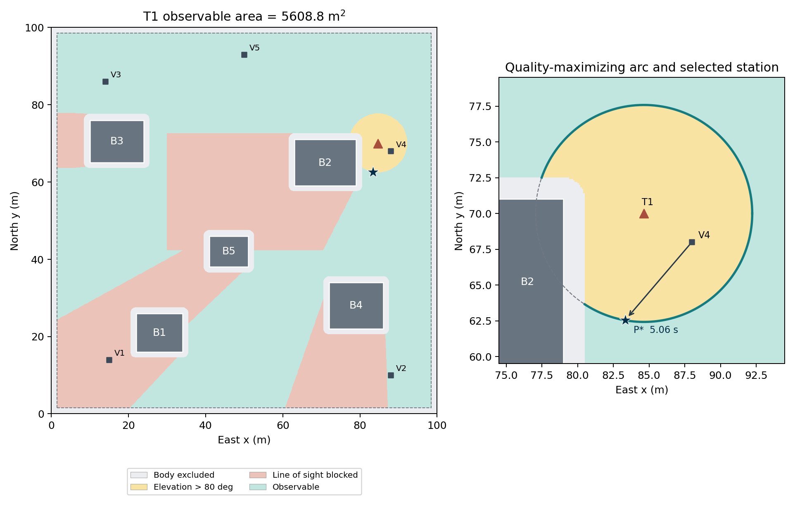
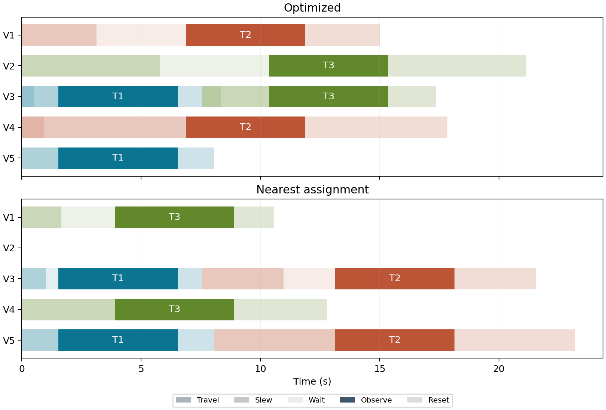
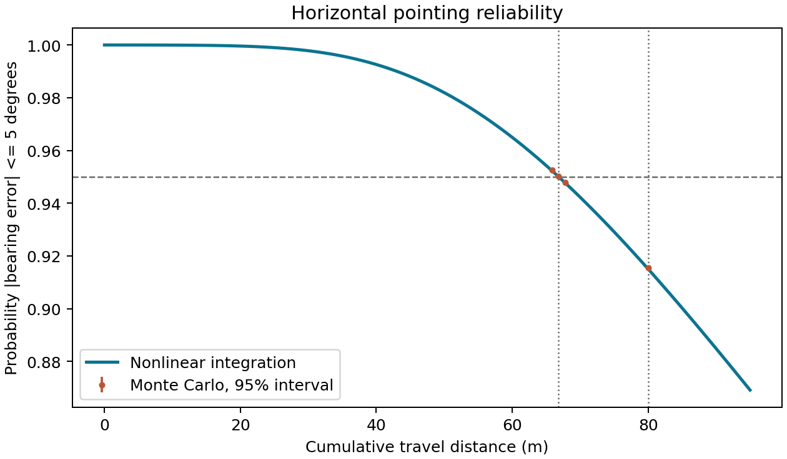
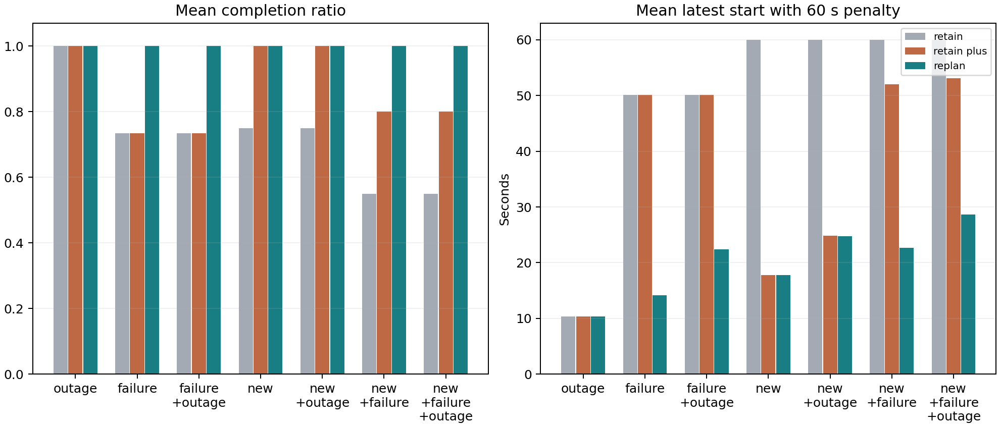

# 数维杯 B 题当前算法详解

本说明沿着 [主程序](main.py) 的执行顺序展开。每问给出输入、公式推导、程序如何求解，以及如何用输出检查结论。[数学建模解答](SOLUTION.md) 汇总论文正文，[README](README.md) 提供运行命令和结果入口，[数值汇总](results/summary.json) 保存未舍入的数据。文中的近似数值用于阅读和核算，执行可行性检查时使用程序原始精度。

## 1. 统一模型与程序入口

### 1.1 输入和四问的依赖

场地是 $[0,100]\times[0,100]$ m，$x$ 向东，$y$ 向北。极坐标告警角 $\theta$ 从正东逆时针计，以场地中心 $(50,50)$ 为圆心。若告警为 $(\theta,R,H)$，水平投影和三维目标分别为

$$
T=(50+R\cos\theta,\ 50+R\sin\theta),\qquad T^{(3)}=(T_x,T_y,H).
$$

| 告警 | 方向（°） | 告警半径（m） | 高度 $H$（m） | 水平投影 $(x,y)$（m） |
| --- | ---: | ---: | ---: | --- |
| T1 | 30 | 40 | 45 | (84.641016, 70.000000) |
| T2 | 150 | 45 | 35 | (11.028857, 72.500000) |
| T3 | 285 | 38 | 55 | (59.835124, 13.294819) |

车辆初始位置依次为 V1 $(15,14)$、V2 $(88,10)$、V3 $(14,86)$、V4 $(88,68)$ 和 V5 $(50,93)$。车辆半径 $\rho=1.5$ m，行驶速度 $v_0=3$ m/s，相机高度 $h_c=2$ m。云台横转、俯仰各有 $30^\circ$/s 的速度上限，允许同时转动。原始建筑长宽高和车辆位置均由 [geometry.py](geometry.py) 提供。

- 第一问自己求 T1 的可观测集合，同时给出能达到最小站距的完整圆弧。
- 第二问①由两个带误差的方位观测计算水平定位精度，在精度并列的站对中最小化同时就绪时刻。
- 第二问②对 T1、T2、T3 联合安排车辆对、站点和复用次序。第四问用这类完整调度作为扰动前的计划。
- 第三问描述位置和云台误差对单次指向的影响。程序把该概率模型用于实际站位的诊断，比较名义三告警方案、0.50 m 精度方案及 T2 等精度站对。

本文用 $r_j(P)=\lVert T_j-P\rVert$ 表示车到目标水平投影的距离，用 $d(P,Q)$ 表示车辆沿安全折线的行驶长度，用 $B=\lVert P_1-P_2\rVert$ 表示双站基线。候选站坐标、DRMS、各轴角度、行驶时间和各车释放时刻分别保存在结果中。

### 1.2 模块之间如何传递数据

| 代码 | 主要输入 | 输出与后续用途 |
| --- | --- | --- |
| [geometry.py](geometry.py) | 车辆、建筑、目标、待检查点和线段 | 单点可观测性、视线净空、双站几何、距离矩阵和折线路径 |
| [problem1.py](problem1.py) | T1 和路径计算接口 | 面积分解、最优圆弧、最先准备的车辆与站位 |
| [problem2_accuracy.py](problem2_accuracy.py) | T2 和五车初始位置 | 正交最优站对、连续就绪下界、旧站对证书和模拟统计 |
| [scheduler.py](scheduler.py) | 目标、可用车辆状态、候选站与可行条件 | 调度选择序列、逐车路径、到站与指向时刻 |
| [errors.py](errors.py) | 角度噪声、定位标准差和仿真种子 | 误差分布积分、累计里程阈值和蒙特卡洛置信区间 |
| [experiments.py](experiments.py) | 名义计划、精度与净空条件 | 对照调度实验，以及逐次访问的指向概率 |
| [disturbances.py](disturbances.py) | 扰动前计划、新告警、故障车和恢复时刻 | 恢复前事件、可用状态、新计划与评分 |
| [analysis_metrics.py](analysis_metrics.py) | 求得的计划及已知可行上界 | 调度连续下界和四问图表 |
| [main.py](main.py) | 上述各模块 | 全流程复算、独立核验和 CSV／JSON 导出 |

## 2. 几何与云台的公共可行性模型

### 2.1 车体约束

矩形建筑底面记为 $K_b=[x_b^-,x_b^+]\times[y_b^-,y_b^+]$。车体全部留在场内，等价于车辆中心在缩小后的正方形 $D=[1.5,98.5]^2$ 内。车体与建筑底面内部无重叠等价于

$$
\operatorname{dist}(P,K_b)\ge\rho,\quad
\begin{aligned}
d_x&=\max(x_b^--P_x,\,0,\,P_x-x_b^+),\\
d_y&=\max(y_b^--P_y,\,0,\,P_y-y_b^+),\\
\operatorname{dist}(P,K_b)&=\sqrt{d_x^2+d_y^2}.
\end{aligned}
$$

也可以将车辆简化成质点，把矩形扩张成 $K_b\oplus\mathbb B_\rho$，其中 $\mathbb B_\rho$ 为半径 $\rho$ 的闭圆盘。扩张图形包含四个平移后的直边和四个四分之一圆角。车体可以与建筑相切，中心可以位于扩张图形的边界。代码的单点判定使用到原矩形的距离平方。

### 2.2 相机视线与闭区间裁剪

从 $P$ 处相机到目标的线段可参数化为

$$
L(\lambda)=\bigl(P+\lambda(T-P),\,h_c+\lambda(H-h_c)\bigr),\qquad 0\le\lambda\le1.
$$

本题所有目标在相关建筑顶面以上。对楼高 $h_b$，视线能与建筑接触的部分必有

$$
0\le\lambda\le\ell_b=\min\left(1,\frac{h_b-h_c}{H-h_c}\right).
$$

设 $d_x=T_x-P_x$。若 $d_x\ne0$，令 $a_x=(x_b^--P_x)/d_x$、$b_x=(x_b^+-P_x)/d_x$，交换次序后取得对应的闭参数区间 $I_x=[\min(a_x,b_x),\max(a_x,b_x)]$。若 $d_x=0$，按固定横坐标是否在建筑横坐标范围内，使该维约束分别成为整个参数轴或空集。纵坐标同样求 $I_y$。建筑挡光当且仅当 $I_x\cap I_y\cap[0,\ell_b]\ne\varnothing$。实现 `_box_interval` 将各下端点取最大、上端点取最小。端点接触属于遮挡，因此比较进入和离开参数时保留等号，并对浮点舍入使用容差。

例如，某视线在 $\lambda\in[0.30,0.50]$ 进入建筑的水平投影，但位于楼顶以下的区间只有 $[0,0.20]$。两个区间没有交集，这条视线通过楼顶。完整裁剪也能识别只接触棱或角的情况。

### 2.3 仰角、横转与准备时间

定义 $r=\lVert T-P\rVert$。仰角为 $e(P)=\operatorname{atan2}(H-h_c,r)$。因为 $H>h_c$，本题仰角下限 $-10^\circ$ 自动满足。上限 $80^\circ$ 等价于

$$
r\ge r_0(H)=\frac{H-h_c}{\tan80^\circ}.
$$

令 $\alpha(P)=\operatorname{wrap}_{[-180^\circ,180^\circ)}\operatorname{atan2}(T_y-P_y,T_x-P_x)$，横转角为最短的有符号旋转量。行驶时云台朝东且水平，到站后两轴并行转动。由 $(0^\circ,0^\circ)$ 指向目标所需时长为

$$
g_j(P)=\frac{\max\bigl(\lvert\alpha_j(P)\rvert,\lvert e_j(P)\rvert\bigr)}{30^\circ/\mathrm s}.
$$

例如横转 $80^\circ$、俯仰 $60^\circ$ 时，两轴同时启动，俯仰 2 s 即到位，横转约 2.6667 s 才到位，所以准备时间只累加 2.6667 s。观测完成后，以同样的速度回到朝东水平姿态，完整回正耗时也是 $g_j(P)$。第四问中若任务从中途被撤回，回正按撤回时的实际姿态计算。

可观测集合 $\mathcal O_j$ 是车体可行、视线通畅和仰角合规三种条件的交集。`station_constraints` 返回三张布尔掩码，便于面积分解。`observable` 对三张掩码取逻辑与，供站位求解、候选点筛选和方案复核调用。

## 3. 第一问 T1 连续可观测区域与最早就绪单站

### 3.1 从遮挡判定构造显式阴影

逐点裁剪可以判断某个站行不行。为求整个区域的面积，反解所有恰使视线通过某栋建筑的站位。若 $q=P+\lambda(T-P)\in K_b$，则

$$
P=T+\frac{q-T}{1-\lambda}.
$$

令 $a_b=(1-\ell_b)^{-1}$，$q$ 在矩形内取遍且 $\lambda\in[0,\ell_b]$，站位图形由以目标投影 $T$ 为中心的缩放矩形扫出。它恰好等于

$$
S_b=\operatorname{conv}\bigl(K_b\cup[T+a_b(K_b-T)]\bigr).
$$

可以直接证明这个等号。任意比例 $a\in[1,a_b]$ 的同一矩形点是比例 1 和 $a_b$ 两个对应点的凸组合。反过来，在两个端点矩形各取一点进行凸组合，抽出共同缩放比例后，剩余点是原矩形内部两点的加权平均，仍位于矩形中。因此仅对两组角点求凸包即可得到闭阴影多边形。这个表达式对应 `_shadow_polygons`，与逐点裁剪使用相同的几何条件。

### 3.2 截面区间合并与面积积分

任取横坐标 $x$，在 $D$ 中的纵向可用线段是 $[\rho,100-\rho]$。三类禁区在竖线上的交集可用区间计算。

1. 楼体膨胀区。若 $x$ 到建筑横坐标范围的距离是 $d_x\le\rho$，则禁区纵向区间为 $[y_b^--\sqrt{\rho^2-d_x^2},\ y_b^++\sqrt{\rho^2-d_x^2}]$。
2. 仰角禁入圆盘。当 $\lvert x-T_x\rvert<r_0$ 时，区间端点为 $T_y\pm\sqrt{r_0^2-(x-T_x)^2}$。
3. 光学阴影。用非竖直的多边形边在该 $x$ 处的交点求最低与最高纵坐标。积分在多边形顶点的横坐标处拆开，单一竖边所在的横坐标不影响区域面积。

将区间按下端点排序并裁到车辆中心允许范围。从低向高合并，令 `end` 保存当前已计入位置的最远端，每次只累加新出现的正长度。设 $c_{\rm B}(x)$、$c_{\rm BE}(x)$、$c_{\rm BES}(x)$ 分别为加入车体、仰角以及全部约束后禁区并集的截面长度。独占损失和可观测面积可以按向量一次积分

$$
\begin{pmatrix} A_{\rm B,in}\\ A_{\rm E}\\ A_{\rm S}\\ A_{\rm obs}\end{pmatrix}
=\int_{\rho}^{100-\rho}
\begin{pmatrix}
c_{\rm B}(x)\\
c_{\rm BE}(x)-c_{\rm B}(x)\\
c_{\rm BES}(x)-c_{\rm BE}(x)\\
100-2\rho-c_{\rm BES}(x)
\end{pmatrix}dx.
$$

车体总禁入面积还包括场边缩进的面积 $100^2-(100-2\rho)^2$。用差值统计保证建筑阴影重叠、以及阴影与圆盘重叠的面积只计一次。`quad_vec` 在建筑坐标边界、圆盘左右端点和各阴影顶点处分块，自适应积分。栅格图对单元中心按车辆、仰角、视线、可观测的优先顺序涂色，栅格面积是对应单元数乘以网格面积。

| 方法 | 车体可停靠（m²） | 仰角额外损失（m²） | 遮挡额外损失（m²） | 可观测（m²） |
| --- | ---: | ---: | ---: | ---: |
| 连续截面积分 | 8302.6571 | 157.4395 | 2536.4470 | **5608.7706** |
| 0.125 m 栅格 | 8303.0000 | 157.4375 | 2537.6250 | 5607.9375 |
| 0.100 m 栅格 | 8302.2000 | 157.4500 | 2534.3500 | 5610.4000 |
| 0.050 m 栅格 | 8302.6500 | 157.4325 | 2536.6900 | 5608.5275 |

五个膨胀建筑两两分离且都在 $D$ 内。因此可停车体面积还有独立闭式校验，逐栋扣除原矩形 $w_b d_b$、边条 $2\rho(w_b+d_b)$ 与四个圆角总面积 $\pi\rho^2$。结果为 8302.65708265 m²，和积分结果一致。四类区域合计 10000 m²。五车初始点经三项掩码筛选，V2、V3、V5 可以直接观测 T1，V1 受 B5 遮挡，V4 位于最低站距圆内。



### 3.3 从仰角下界求整条最优弧

第一问的主目标 $Q=1/r$ 在 $r>0$ 上严格递减。任何在可观测集合内的点都有 $r\ge r_0(45)=7.58206017$ m，因此圆周上所有可观测点都达到 $Q^\star=0.13189027\ \mathrm{m}^{-1}$。设圆周点为 $P(\phi)=T+r_0(\cos\phi,\sin\phi)$。`_optimal_intervals` 用以下步骤求角区间。

```text
收集圆周与场界直线、膨胀矩形直边所在直线的交角
收集圆周与四个建筑角点为圆心、车辆半径为半径的圆的交角
收集圆周与各阴影多边形边所在直线的交角
加入 0 和 2π，排序去重
逐段测试中点，同时独立测试每个端点
仅在共同端点可行时合并相邻区间
```

圆和直线 $\boldsymbol n\cdot P=c$ 的交角可由 $\cos(\phi-\phi_n)=(c-\boldsymbol n\cdot T)/(r_0\lVert\boldsymbol n\rVert)$ 求出。两个圆相交时，将距离平方方程相减，得到一条根轴，再按直线求交。程序使用整条支撑直线及完整角点圆，这会多产生一些切分角。中点和端点复验会把实际可行的段合并回来。真实可行性发生变化前必先经过边界，因此这种切分能确定完整的最优点集。

T1 最优弧为 $[236.89605^\circ,360^\circ]\cup[0^\circ,160.74787^\circ]$，合计 **283.85183°**，弧长 37.56266 m。两个关键端点分别与 B2 的东侧中心限位 $x=80.5$ 和北侧中心限位 $y=72.5$ 相切，均满足闭视线裁剪。

### 3.4 同一观测质量下的最早准备证明

在弧上所有站位和五车中，二级目标最小化 $d(P_i^0,P)/3+g_1(P)$。将路径放宽为直线。记 $D_i=\lVert P_i^0-T\rVert$，则车辆到圆周的最短欧氏距离是 $\lvert D_i-r_0\rvert$，而圆上最短指向时间为 $80/30$ s。V1、V2、V3、V5 的总时间下界分别约为 29.927、20.171、24.283 和 14.000 s。

对 V4，初始方向 $\phi_0\approx329.22966^\circ$。将直线距离式中的两个点同时旋转 $-\phi$，观测站固定在 $(r_0,0)$，初始车点在半径 $D_4$ 的圆上转动。由距离的三角不等式，直线行驶时间关于弧度角的变化率绝对值至多 $D_4/3\approx1.303$ s/rad。所需横转角的绝对值在 $0^\circ$ 至 $180^\circ$ 从 180° 降到 0°，随后升回 180°。由此得到三个角段的变化规律。

- 当 $\phi$ 在 0° 至 100° 内，横转决定指向时间，斜率为 $-180/(30\pi)$ s/rad。
- 100° 至 260° 内指向时间恒为 $80/30$ s。
- 260° 至 360° 内横转决定指向时间，斜率为 $180/(30\pi)$ s/rad。

横转主导两段的斜率绝对值约 1.910 s/rad，超过行驶项的变化率上界，故总时间分别严格递减和严格递增。中间段最近方向需要在区间内才可能给出内部最小值，V4 的 $\phi_0$ 在区间外。比较两个端点，260° 更早。这个点位于确定的最优弧，V4 可以直线到达，所以放宽问题的最小值可达到。其他四车的下界都更晚，给出两级最优证明。

最终 V4 驶往 **$(83.32440522,62.53312836)$ m**，路径长 7.19360 m，行驶 2.39787 s。横转与俯仰都约为 80°，指向 2.66667 s，合计 **5.06453 s**。正东站也达到相同 $Q^\star$，在该站 V4 所需横转为 180°，准备约 7.55758 s。按就绪时间择优节约约 2.493 s。

## 4. 第二问① T2 双站定位、误差传播与等精度择优

### 4.1 方位测量如何定义水平交会

第 $i$ 个站位为 $P_i$，二维真目标为 $T$。设 $u(\alpha)=(\cos\alpha,\sin\alpha)$，方位测量为

$$
\widehat\alpha_i=\operatorname{atan2}(T_y-P_{i,y},\,T_x-P_{i,x})+\varepsilon_i,
\qquad \varepsilon_i\sim N(0,\sigma_\alpha^2).
$$

两站独立，$\sigma_\alpha=1^\circ=\pi/180$ rad。观测直线分别为 $P_1+t_1u(\widehat\alpha_1)$ 和 $P_2+t_2u(\widehat\alpha_2)$。令两式相等，对第二条直线方向取二维叉积可消去 $t_2$，得到

$$
\widehat T=P_1+
\frac{(P_2-P_1)\times u(\widehat\alpha_2)}
     {u(\widehat\alpha_1)\times u(\widehat\alpha_2)}
     u(\widehat\alpha_1).
$$

二维叉积 $a\times b=a_xb_y-a_yb_x$，分母是测量方向差的正弦。双站交会在这里解的是水平面位置，告警高度用于计算可观测性和仰角。一个站给出一条方位线，提供垂直于视线的横向约束。两条非平行的方位线才对两个水平坐标都提供约束。

### 4.2 用雅可比矩阵传播方位误差

由 $\operatorname{atan2}$ 对平面坐标的导数，

$$
A_{i:}=
\left[-\frac{T_y-P_{i,y}}{r_i^2},\ \frac{T_x-P_{i,x}}{r_i^2}\right]
=\frac{1}{r_i}[-\sin\alpha_i,\ \cos\alpha_i].
$$

当测角误差小且交会几何良态，$\varepsilon\approx A(\widehat T-T)$，所以 $\widehat T-T\approx A^{-1}\varepsilon$。用 $\operatorname{Cov}(LX)=L\operatorname{Cov}(X)L^\mathsf T$ 得到

$$
\Sigma_T\approx\sigma_\alpha^2 A^{-1}A^{-\mathsf T}
             =\sigma_\alpha^2(A^\mathsf T A)^{-1}.
$$

$A_{i:}$ 的方向垂直于该站的视线，分母为站距。对给定小角度误差，站距越大，误差对应的横向位移越大。若两行接近共线，协方差在几何弱方向被放大。

程序使用水平距离均方根 DRMS，$J=\sqrt{\operatorname{tr}\Sigma_T}$。设 $\gamma\in[0^\circ,180^\circ]$ 为两条真方位方向之间的夹角。由行向量的长度与夹角可得

$$
\operatorname{tr}(A^\mathsf T A)=\frac{1}{r_1^2}+\frac{1}{r_2^2},
\qquad
\det(A^\mathsf T A)=\frac{\sin^2\gamma}{r_1^2r_2^2}.
$$

对 $2\times 2$ 可逆矩阵，其逆的迹等于原矩阵的迹除以行列式。代入即得

$$
\boxed{J=\sigma_\alpha\frac{\sqrt{r_1^2+r_2^2}}{\lvert\sin\gamma\rvert}},
\qquad
B^2=r_1^2+r_2^2-2r_1r_2\cos\gamma.
$$

这个指标以米计，坐标系旋转不会改变迹。保持 $r_1,r_2$ 不变时，交会角从小角度扩大到 90° 会改善精度，从 90° 继续向 180° 扩大则使精度退化。这个例子也说明单报基线长度不足以描述精度。程序 `pair_geometry` 用点积与叉积的 `atan2` 计算交会角，然后计算基线和 DRMS。

### 4.3 最低 DRMS 的解析下界

T2 的高度是 35 m，$r_0=33/\tan80^\circ=5.81879036$ m。对任意可观测站对，$r_1,r_2\ge r_0$ 且 $\lvert\sin\gamma\rvert\le 1$，因而

$$
J\ge J_{\min}=\sqrt{2}\sigma_\alpha r_0=0.1436233579\ {\rm m}.
$$

取等必须让两站都在最小站距圆上，并相差 90°。西站 $(5.21006647,72.5)$ 与北站 $(11.02885683,78.31879036)$ 能分别由 V1、V3 走直线路径到达，行驶用时约 19.77117 s、2.74527 s。两站通过视线、车体和仰角核验，故上述下界能达到。西、北站对仍存为 `west_north_certificate`，它们在旧方案中的同步就绪时刻为 22.43784 s。

双站选择中的 30 s 限制判断各车的行驶时间 $d/3$。二级目标的就绪时间再计入转动时间，取两车准备完毕的较晚时刻。因此按“行驶距离短”选站与按“行驶加指向后最快同步”选站可能得到不同代表站对。

### 4.4 将等精度站对缩成一维角度

使用同一目标投影 $T$ 作圆心。第一站取 $P(\phi)$，第二站取 $P(\phi+\pi/2)$。任意一对正交站通过适当排序都可写成这种形式，因此有序枚举也同时包含车辆互换的情形。

`_pair_arc_closures` 先计算 T2 最小站距圆的可观测角段，再把第二站可观测角段向前移动 $\pi/2$ 并对齐周期，最后和第一站角段求交。其中一阶最优站对的第一角可行区间闭包为 $[59.657508^\circ,154.240041^\circ]$。闭包用于计算下界，生成真实站点时再次验证两站可见性和可视图点是否可进入。这样可以利用线段裁剪的接触规则排除实际不可用的端点。

设给定有序车辆对 $(i,k)$ 的精确目标为

$$
F_{ik}(\phi)=
\max\left\{
\frac{d(P_i^0,P(\phi))}{3}+g(P(\phi)),\
\frac{d(P_k^0,P(\phi+\pi/2))}{3}+g(P(\phi+\pi/2))
\right\}.
$$

程序在可行角域按 0.05° 扫描，并插入理论分段端点与驻点，共保留 1908 个可行第一角候选。对每个不同车辆的有序分配计算两路行驶时间，剔除任一路超过 30 s 的组合，找同步时刻最早者。

### 4.5 连续最早为何可以证明

扫描给出真实可行的上界。证明下界时，将行驶距离替换为欧氏距离，并放宽 30 s 行驶过滤。对整段角域 $I$、有序车对 $(i,k)$，记两车直线准备时间为 $f_i$、$f_k$。显然

$$
\min_{\phi\in I}F_{ik}(\phi)\ge
\max\left\{\min_{\phi\in I}f_i(\phi),\
           \min_{\phi\in I}f_k(\phi+\pi/2)\right\}.
$$

分别对两辆车取最小值会忽略它们必须用同一个 $\phi$ 的关系，因此右侧可以偏小，适合作为下界。对所有有序分配和各个连通角段取最小值，得到全体等精度站对的同步时间下界。

单车最小值可以用有限个理论角来确定。将初始车相对目标的极坐标记为 $(D,\phi_0)$，欧氏路程为

$$
d_{\mathrm E}(\phi)=\sqrt{a-2b\cos(\phi-\phi_0)},
\qquad
a=r_0^2+D^2,\quad b=r_0D.
$$

在恒定俯仰主导段，检查角区间端点、离车最近和最远的方向。横转主导段内，指向时长对弧度角的导数为常数 $\pm k_\theta$，其中 $k_\theta=180/(30\pi)$。令行驶与指向时长之和的导数为零并平方，取 $x=\cos(\phi-\phi_0)$，得到

$$
b^2x^2-2c b x+ca-b^2=0,\qquad c=(3k_\theta)^2.
$$

程序将实根且满足 $\lvert x\rvert\le1$ 的候选角、0°／100°／260° 转动分段点及两端角一并代入实际函数取最小值。由平方引入的多余候选角只会增加评估点，每个评估值都是对应角上的真实直线就绪时间。所有理论驻点和转折角都被纳入。第二站的计算把这些候选角整体平移 $-\pi/2$，与第一站共享同一参数。

最终下界等于 **16.87412545 s**。V5 的第一站恰取 100° 分段点，V3 的第二站取 190°。两条实际路径均为可行直线，且同步时间等于上述下界，所以连续域的二级目标也达到全局最优。其他有序车辆对的最小直线同步下界至少约 18.45607 s。

| 车辆 | 圆周角（°） | 站位 $(x,y)$（m） | 行驶（s） | 指向（s） | 就绪（s） |
| --- | ---: | --- | ---: | ---: | ---: |
| V5 | 100 | (10.01843449, 78.23038986) | 14.20746 | 2.66667 | **16.87413** |
| V3 | 190 | (5.29846697, 71.48957766) | 5.63983 | 2.66667 | 8.30650 |

两站距均为 5.81879036 m，基线为 8.22901225 m，交会角为 90°。和西、北站对相比，同步就绪提前约 **5.56371 s**。连续下界、各有序分配下界、原对照路线及新路线见 [数值汇总中的 Q2 定位结果](results/summary.json)。

### 4.6 非线性模拟与精度适用范围

正交且等站距时，两个水平坐标方向具有相同的一阶方差，$\Sigma_T\approx 0.01031383I_2$ m²。`validate_intersection` 用固定随机种子产生 300000 对方位误差，按真实直线交点公式计算 $\widehat T$，再统计径向误差 $\lVert \widehat T-T\rVert$。为避免病态角支配样本统计，模拟将距 0° 或 180° 小于 10° 的测量交会角排除。该最优站对实际剔除 0 个样本，模拟条件 RMSE 为 0.14366386 m，95% 径向误差分位数为 0.24825745 m。

一阶 DRMS 描述名义几何附近的小扰动尺度。在任意接近平行的方位测量下，直线交点公式含接近零的分母，其极端误差会使无截断总体二阶矩发散。这也是单独报告线性指标和含明确截断规则的模拟统计的原因。第五节里的 0.50 m 约束使用这个一阶名义精度。第六节的单车指向概率另由车辆位置误差和云台误差计算。

## 5. 第二问② 多告警路径、车辆复用和同步调度

### 5.1 用可视图求保守安全路径

车辆中心在场地内绕开圆角膨胀建筑。`Router` 用外切凸多边形近似每个膨胀建筑。每个 90° 圆角使用 4 个等分切线方向，切线交点半径为 $\rho/\cos 11.25^\circ$，多边形向外最多增加 $\rho(\sec 11.25^\circ-1)\approx0.0294$ m。因此多边形外的路径对真实圆盘车辆也是安全的。可视图中的最短路针对这个保守膨胀障碍模型。数值界中使用的欧氏下界仍适用于真实的圆角车辆几何。

图的结点是所有膨胀建筑的顶点，5 栋楼一共 80 个顶点。任意两个点的连线若不进入某个多边形内部，就可作为可视边，代价为线段欧氏长度。对一座凸障碍，`direct_matrix` 将每条边表达成一个朝内半平面。连线若在同一个参数区间同时位于全部朝内半平面内部，就穿过了该障碍。允许路径在安全膨胀外边界上相切。对与障碍包围盒完全不相交的线段，直接略过半平面判断。

所有固定顶点之间的距离采用 Floyd–Warshall 预计算。若已知只经过前 $k-1$ 个顶点的最短距离 $D^{(k-1)}_{ab}$，则

$$
D^{(k)}_{ab}=\min\left(D^{(k-1)}_{ab},D^{(k-1)}_{ak}+D^{(k-1)}_{kb}\right).
$$

查询任意端点 $P,Q$ 时，比较直达与经图顶点的最短组合

$$
d(P,Q)=\min\left(d_{\rm direct}(P,Q),
\min_{a,b}\{d_{\rm direct}(P,a)+D_{ab}+d_{\rm direct}(b,Q)\}\right).
$$

被挡住的直连长度置为 $+\infty$。直连如果存在，其长度已经达到欧氏下界。否则按取得最小值的进入和离开顶点恢复路线，`next_node` 记录顶点间的第一跳。调度搜索使用距离矩阵，输出阶段再调用 `Router.path` 取折点。`main.verify` 另按原建筑与路径段间的最短距离逐段复查半径净空，同时复查 3 m/s 行驶速度和场地边界。

### 5.2 从站点和分工算出完整时序

每辆车 $v$ 的动态状态包含当前位置 $p_v$ 和整备完毕时刻 $F_v$。初始 $F_v=0$。若车 $v$ 为告警 $j$ 去站点 $P_{vj}$，则到站时刻 $A_{vj}$ 和准备完毕时刻 $R_{vj}$ 为

$$
A_{vj}=F_v+\frac{d(p_v,P_{vj})}{v_0},\qquad
R_{vj}=A_{vj}+g_j(P_{vj}).
$$

令 $U_j$ 是两辆不同车辆组成的站对，则最早同步时刻为 $S_j=\max_{v\in U_j}R_{vj}$，观测结束于 $S_j+5$。参与车辆回正后才能再次出发，状态更新为

$$
p_v\gets P_{vj},\qquad F_v\gets S_j+5+g_j(P_{vj}).
$$

程序按同步开始时刻非降序记录告警。扩展一个搜索状态时，还要求新任务的 $S_j$ 不早于该状态的 `latest`。这个条件规范任务输出顺序，由不同车辆负责的任务仍可同时行驶、指向、观测。一辆车可能早于该告警的同步时刻准备完毕，差值 $S_j-R_{vj}$ 就是同步等待。行驶长度为零时可以直接开始站内动作。

三个告警共有六个车辆使用槽，五车中至少有一辆复用。题面目标为 $\min M$，其中 $M=\max_j S_j$。所有同时观测站对要求中心间距至少 3 m，名义版用 $\gamma\in[0.01^\circ,179.99^\circ]$ 排除数值上接近平行的组合。第二问①的 30 s 是 T2 单独选站的行驶限时。第二问②的名义求解调用带 60 s 搜索截止，当前求得计划都远早于该截止。第 5.9 节的调度实验使用无限搜索截止，第四问则按题面保留 60 s 评分窗口。

### 5.3 数据结构与候选站预计算

- `Space.points` 保存去重后的坐标。基本候选来自规则格点、场边中心限位点、五车初始位置与调用方指定的锚点，以及各目标 $r_0$ 和 $1.5r_0$ 的圆周点，标准环的角步长为 15°。
- `station_ids[j]` 保存能服务告警 $j$ 的全局点索引。筛选同时使用原始可观测性和外切多边形路径可进入性。设置视线净空时，还要求每个站的三维视线与建筑有规定的间距。
- `Space.travel[a,b]` 是两个点之间的行驶时间。`slews[j]` 是目标 $j$ 的有效候选站云台指向时长。
- `compatible[j][p,q]` 是目标 $j$ 的局部站索引构成的布尔矩阵。它标记基线、交会角以及可选 DRMS 门槛同时成立的站对。
- `State` 存放各车的位置索引、可出发时间、按先后排列的 `Choice` 列表和最近同步时刻。`Choice` 记录一个告警的两车、两站和观测开始时刻。
- `build_plan` 从 `Choice` 重建 `Mission` 和两条 `Leg`。车辆在断联恢复时的位置可以由 `origins` 增加到距离矩阵。这些起点的位置索引用于路径查询，候选观测站和站对表沿用原来的索引关系。

当有精度上限 $J_{\max}$ 时，可先按半径排除过远的单站。对任一站 $p$ 及其可能配对站 $q$，

$$
J(p,q)\ge\sigma_\alpha\sqrt{r_p^2+r_0^2}.
$$

如果右侧已经大于上限，任何站对都无法使用 $p$。站对矩阵再用 $\sigma_\alpha\sqrt{r_p^2+r_q^2}\le J_{\max}\lvert\sin\gamma\rvert$ 判定精度，以免对接近零的正弦做除法。角度窗 $[a,180^\circ-a]$ 等价于在 0° 至 180° 内要求 $\lvert\sin\gamma\rvert\ge\sin a$。基线通过两点距离平方测试。

### 5.4 单车复用结构的精确离散枚举

先单独求一个明确的子问题。假定五辆车都使用，且只有一辆车执行两次。记复用车为 $i$，先做 $j$ 再做 $k$，搭档分别为 $u,v$，第三个告警由剩下两车执行。三告警有 6 种有序前后组合，车的分配有 $5\times4\times3$ 种，总计 360 种结构。

固定该结构，设复用车第一站为 $p$。对搭档 $u$ 的到站加指向时间排序，从最早开始找第一个与 $p$ 兼容的站点。这一步在每个 $p$ 上预先做，所得搭档最早就绪记为 $b_{j,u}(p)$。第一场同步时刻可直接确定为

$$
S_j(p)=\max\{R_{ij}(p),b_{j,u}(p)\}.
$$

更早完成第一场只会让 $i$ 更早转场，因此不用保留同一个 $p$ 下更慢的搭档。对于第二站 $q$，让 $i$ 最早准备的第一站通过对 $p$ 求最小得到

$$
R_{ik}^{\min}(q)=
\min_p\left[S_j(p)+5+g_j(p)+\frac{d(p,q)}3\right]+g_k(q).
$$

令 $b_{k,v}(q)$ 为第二个搭档在兼容站的最早准备时间，第二个告警最早开始为 $\min_q\max\{R_{ik}^{\min}(q),b_{k,v}(q)\}$。与剩余两车独立告警的最早开始取最大，得到该结构的目标值。程序用数组合并并求 `min` 与 `argmin`，同时记下实现最小值的站位。当已知可行上界时，可以淘汰连第二场最低指向时长都加不进上界的第一站。这个方法在给定候选集合和“一车复用、其余各一次”的结构里覆盖所有选择。

### 5.5 束搜索处理更一般的分工与次序

也可能存在两车分别复用、部分车辆闲置的方案。`solve` 用已安排告警的位掩码分组，对每个组保留有限个状态。每次加入一个未安排告警，枚举两辆当前可用的车，并在各自就绪较早的候选站内查找兼容组合。

```text
按已安排告警的子集建立状态组，空集初始只有一项
依次处理每个子集内保留的状态
    选择一个尚未加入的告警
    枚举两辆可派车辆
    找两车最早准备的站位短名单
    用 compatible 过滤不可行的站对
    按局部评分保留少量不同组合，并更新车辆位置、释放时刻
    计算剩余告警的乐观就绪时间，对新子集内状态排序、去重、截断
以已安排告警数最多、最晚开始时刻最小的状态为输出
```

题面名义三告警调用时使用束宽 24、每车短名单 14、每车对最多保留 3 个站对。实验用 26、30、4。重调度用每车短名单 18、每车对最多保留 3 个，常规束宽 8，压力测试束宽 12。若第一层短名单无解，扩至 $\max(3\times\text{短名单长度},40)$。增强约束下再无解时可搜索完整站集合。

每个车对的局部评分为

$$
S_j+0.04(g_i+g_k)+0.02(R_{ij}+R_{kj}),
$$

少量权重鼓励留下指向与等待开销较小的组合，最终指标仍由 $M$ 或完成率和最晚开始时刻决定。对子集内新状态排序时，剩余每个告警的下界取全体车辆独立准备时间中第二小值，忽略兼容站对与跨告警竞争。这个下界与当前 `latest` 取最大，作为首要排序键。同一车辆位置和按 8 位小数舍入的可出发时刻用作去重键。束宽和局部站对数量决定候选覆盖，结果是经过可行性校验的近似解。

### 5.6 连续细化与最近分配对照

`refine` 固定车辆分工和任务序列，从离散计划出发逐点尝试连续移动。八个搜索方向相差 45°。步长依次为 2、1、0.5、0.25、0.10、0.05、0.02、0.01 m，每档最多 3 轮。每次改站都用 `evaluate_fixed` 重算全部路径、云台时长和复用链的各时刻，应用同一精度、夹角和净空条件。评价按最晚开始、开始时刻总和、总行驶时间依次比较。近邻无改进时结束该步长。题面分别跑 5、3、2 m 三个候选格距，从单车复用枚举和束搜索的可行种子中细化。

最近分配在每轮对各剩余告警和车辆对保留一组两车行驶时间和最小的兼容站点，再从这些动作中选总行驶时间最短者。因速度相同，这与最短总里程等价。动作之间距离并列时取同步时刻更早者，再按告警编号决胜。加入任务后，两种方法都按同一观察与回正时序更新车辆。最近方案优化的是当前派单的移动量，因此它可能留下更长的复用和云台等待链。

| 候选格距（m） | 候选点数 | 束搜索（s） | 单车复用离散枚举（s） | 细化后（s） | 最近分配（s） |
| ---: | ---: | ---: | ---: | ---: | ---: |
| 5 | 507 | 10.8296 | 10.8296 | 10.8296 | 13.1392 |
| 3 | 1141 | 10.8296 | 10.8296 | 10.8296 | 13.1392 |
| 2 | 2425 | 10.6536 | 10.5674 | 10.3688 | 13.1392 |

名义优化调度给 V3 分配 T1→T3，其余车辆各完成一项。下表的时间都以 $t=0$ 为零点。

| 车辆 | 告警 | 站点（m） | 出发（s） | 到站（s） | 准备完毕（s） | 同步开始（s） | 观测结束（s） | 回正结束（s） |
| --- | --- | --- | ---: | ---: | ---: | ---: | ---: | ---: |
| V3 | T1 | (14.9899, 87.1314) | 0.0000 | 0.5011 | 1.5325 | 1.5325 | 6.5325 | 7.5639 |
| V5 | T1 | (50.0000, 93.0000) | 0.0000 | 0.0000 | 1.5320 | 1.5325 | 6.5325 | 8.0646 |
| V1 | T2 | (15.0000, 14.0000) | 0.0000 | 0.0000 | 3.1294 | 6.8923 | 11.8923 | 15.0218 |
| V4 | T2 | (87.9932, 70.8032) | 0.0000 | 0.9344 | 6.8923 | 6.8923 | 11.8923 | 17.8502 |
| V2 | T3 | (88.0011, 10.0011) | 0.0000 | 0.0005 | 5.7782 | 10.3688 | 15.3688 | 21.1465 |
| V3 | T3 | (16.6718, 88.8282) | 7.5639 | 8.3603 | 10.3688 | 10.3688 | 15.3688 | 17.3773 |

| 告警 | 车辆 | 基线（m） | 交会角（°） | 一阶 DRMS（m） |
| --- | --- | ---: | ---: | ---: |
| T1 | V3＋V5 | 35.4985 | 19.7641 | 4.2792 |
| T2 | V1＋V4 | 92.4912 | 84.8536 | 1.6958 |
| T3 | V2＋V3 | 106.3090 | 126.4155 | 1.9845 |

以 V3 为例，初次转向后在 1.5325 s 参与 T1。观察结束于 6.5325 s，回正约需 1.0314 s，故 7.5639 s 即可出发。第二段路长约 2.3891 m，8.3603 s 到站，再用约 2.0085 s 完成指向，于 **10.3688 s** 启动 T3。V2 在约 5.7782 s 已准备完毕，因此等待 V3。最近法让 V3 和 V5 都复用，待 V5 结束 T1 后，其回正结束于约 8.0641 s，原地再次指向 T2 又花约 5.0751 s，成为 **13.1392 s** 的关键链。优化最晚开始较最近分配提前约 21.09%。逐动作记录见 [名义调度时间轴](results/q2_vehicle_timelines.csv)。



### 5.7 独立的连续下界

任何覆盖三个告警的调度至少有一辆车 $v$ 依次执行两个不同告警 $j\to k$。只跟踪这一链，就能得到对全问题成立的下界。把中心可行正方形覆盖为小方格，第一、第二站分别处于方格 $C,D'$。用点到格和格到格的最短欧氏距离替代真实行驶距离。设方格半边长为 $h$，中心为 $c$。最远站距可取

$$
r_{\max}(C)=\sqrt{(\lvert T_x-c_x\rvert+h)^2+(\lvert T_y-c_y\rvert+h)^2}.
$$

对应仰角是格内仰角的下界。用外接圆包围方格，其半径是 $\delta=\sqrt{2}h$。若中心距目标为 $r_c>\delta$，可视方向相对中心方向的最大偏移不超过 $\arcsin(\delta/r_c)$。将中心横转绝对值减去最大偏移，再与 0 取最大，得到横转下界。若 $r_c\le\delta$ 则取零横转下界。两个角下界取最大再除以转速，即 $\underline g_j(C)$。

格内所有点都小于最低站距、整格都落在某个膨胀建筑内，或者同一个视线参数使格内每条线都触及同一建筑时，该格对目标不可用。整格光学判定将格的左右端投影同时约束在建筑底面范围内，对同一 $\lambda$ 做分轴区间裁剪。边界不能确定时保留该格，这有利于保持下界有效。

令 $\underline b_{-v,j}$ 是除 $v$ 外的车辆单独为 $j$ 准备的最早下界。复用车第一场至少等待自己和一位搭档，之后观测 5 s、回正、开到第二格、再次指向，所以

$$
\begin{aligned}
L_{v,j,k}(C,D')={}&
\max\left\{
\frac{\operatorname{dist}(P_v^0,C)}3+\underline g_j(C),\
\underline b_{-v,j}
\right\}
+5+\underline g_j(C)\\
&+\frac{\operatorname{dist}(C,D')}3+\underline g_k(D').
\end{aligned}
$$

对所有格对、车辆、有序告警对取最小值。这里允许自由选择任何第一场搭档，放宽了绕障路径、另一站的几何约束和其余任务的资源竞争。任何全局可行调度都包含至少一条这样的复用链，故所得值是原目标连续下界。`_bounded_chain` 使用当前可行上界剔除已无望改善的第一格。对剩余第一格，按时间预算给出第二格中心的搜索半径，并增加两格外接圆半径，用 KD-tree 排除明显过远的第二格，再精确算格间最短欧氏距离。

| 下界的方格边长（m） | 连续下界（s） |
| ---: | ---: |
| 1.000 | 9.55312 |
| 0.500 | 10.01361 |
| 0.250 | 10.12881 |
| 0.125 | **10.24771** |

因此题面场景的连续最优值或下确界落在 **[10.24771, 10.36879] s**。现有题面方案与下界的差约 0.12108 s，相对下界约 1.18%。下界格距与调度候选格距是两套参数。前者覆盖连续域并放宽问题，后者枚举真实可行点并给出可行时间。

### 5.8 三维视线净空的计算

单点可观测性裁剪判定的是视线有无接触。净空实验还需要量化它离楼体多远。把建筑实体记为三维轴对齐盒 $[l_i,h_i]$，相机视线为 $X(\lambda)=A+\lambda u$。单栋楼的净空平方是

$$
\min_{0\le\lambda\le1}
\sum_{i=1}^3
\max\{l_i-X_i(\lambda),\,0,\,X_i(\lambda)-h_i\}^{2}.
$$

对每维求相机线段穿过两侧边界平面的参数，和 0、1 一起排序。每个子区间内，最近点到盒子的距离在哪些维度由低面或高面决定保持固定。以其中点判断各维状态，平方和就变成若干 $(a_i+b_i\lambda)^2$ 的和。若 $\sum b_i^2>0$，驻点 $\lambda^\star=-\sum a_i b_i/\sum b_i^2$ 再夹到该子区间。若曲率为零，区间中的距离平方恒定，取端点即可。对子区间和所有楼取最小值后开平方，得到 `los_clearance`。仰角、车辆路径净空和双站间距仍按各自规则检查。

名义优化方案有两条临界视线。V4→T2 到 B2 的最小距离约 **1.49 mm**，V3→T3 到 B3 的最小距离约 **2.10 mm**。因此用 0.05、0.10 m 约束重新找可行站位，量化追加裕量的用时。

### 5.9 净空与定位精度实验

净空试验对三个档位都用 3 m 场地格点和同一组局部锚点。这些锚点围绕名义站位按 22.5° 角步长、半径 0.025、0.05、0.10、0.20、0.40、0.80 和 1.60 m 构造。按从严到松顺序求解，较严格的可行计划也参与下一个档位的候选，以减少仅由搜索波动造成的逆序。零净空仍执行闭区间视线判定。

0.50 m DRMS 实验在 3 m 场地点之外，为目标区域加入 10° 角步长、2 m 径向步长的极坐标候选，并用半径必要条件裁剪。所有方案统一要求交会角 30°–150° 和 $J\le0.50$ m。该实验保留原可观测条件，视线净空与精度两套门槛分别验证。

| 条件 | 候选池点数 | 最好离散值（s） | 优化后（s） | 同条件最近分配（s） |
| --- | ---: | ---: | ---: | ---: |
| 0 m 净空 | 1817 | 10.3688 | 10.3618 | 13.1392 |
| 0.05 m 净空 | 1817 | 10.4015 | 10.3913 | 13.1392 |
| 0.10 m 净空 | 1816 | 10.4710 | 10.4294 | 13.1392 |
| DRMS ≤ 0.50 m，交会角 30°–150° | 1308 | 25.8492 | 25.0533 | 30.4530 |

对于相同锚点的净空试验，5 cm、10 cm 档比 0 cm 档的最晚开始分别增加约 0.0295、0.0675 s。10 cm 档实际最小视线净空约 0.10008 m。0 cm 档搜索得到 10.3618 s，锚点和细化增加了可行候选。该值也可以作为题面连续问题的更紧上界，与 10.24771 s 的下界相差约 0.11413 s。第四问题面组沿用第 5.6 节完整名义计划作为共同初始调度。

| 0.50 m 精度优化方案 | 车辆对 | 开始（s） | 交会角（°） | 一阶 DRMS（m） | 最小视线净空（m） |
| --- | --- | ---: | ---: | ---: | ---: |
| T1 | V4＋V5 | 9.7237 | 92.3521 | 0.499995 | 0.052949 |
| T2 | V1＋V3 | 13.2809 | 95.2237 | 0.499964 | 2.923379 |
| T3 | V4＋V2 | 25.0533 | 89.4613 | 0.499991 | 5.243271 |

精度版本最晚开始 **25.0533 s**，比同门槛最近分配的 **30.4530 s** 快约 5.40 s。严格的几何测角精度要求车辆更靠近目标并形成夹角良好的站对，因而需要支付更多行驶时间。此处报告的是当前搜索的可行值。各次试验的分工和实际约束值可在 [调度实验表](results/q2_schedule_experiments.csv) 核对，阶段细节由 [实验时间轴](results/q2_experiment_timelines.csv) 给出。

## 6. 第三问 位置漂移与云台误差的概率传播

### 6.1 坐标旋转与小误差近似

令车辆真位置为原点，把横轴旋到真实目标方向。站距为 $r$ 时，目标写成 $(r,0)$。位置估计误差平行、垂直分量记作 $\delta_x,\delta_y$。题面给两个方向独立同方差的正态误差，旋转坐标后仍有 $\delta_x,\delta_y\sim N(0,\sigma^2)$，其中 $\sigma(s)=0.3+0.02s$ m，$s$ 为车辆从最初位置出发累计行驶的路径长度。由估计车位计算的目标向量为 $(r-\delta_x,-\delta_y)$，于是几何指向误差的弧度值为 $\beta=\operatorname{atan2}(-\delta_y,r-\delta_x)$。

考虑独立的云台零偏 $E_0\sim N(0,0.8^2)$ 度和控制误差 $E_c\sim N(0,0.6^2)$ 度。有效指向误差为

$$
\Delta\psi=\operatorname{wrap}_{[-180^\circ,180^\circ)}
\left(\frac{180}{\pi}\beta+E_0+E_c\right).
$$

位置误差相对于站距较小时，$\beta\approx-\delta_y/r$。在真目标方向的切线方向上，横向位置误差直接产生角偏差，平行分量在一阶展开中消失。忽略二阶与回绕尾部后，

$$
\sigma_{\psi,{\rm lin}}^2
=\left(\frac{180}{\pi}\frac{\sigma(s)}r\right)^2+0.8^2+0.6^2.
$$

定位项以角误差方差进入，单位已换成度平方。零偏和控制误差的方差和恰为 $1\,{\rm deg}^2$。第二问中的 $1^\circ$ 描述已获得的方位测量噪声，用来计算双站交点误差。这里的云台噪声方差用于计算车辆能否指准目标。

正态近似下，$P(\lvert\Delta\psi\rvert\le5^\circ)=2\Phi(5/\sigma_{\psi,{\rm lin}})-1$。令成功概率达到 95%，得到所需 $\sigma_{\psi,{\rm lin}}\le5/\Phi^{-1}(0.975)$。代入 $r=40$ m 解出近似里程上限 **66.9223 m**。

### 6.2 投影正态角度密度的推导

最终采用非线性 $\operatorname{atan2}$ 模型。先把几何向量除以 $\sigma$，记 $m=r/\sigma$。标准化后相当于 $(X,Y)\sim N((m,0),I_2)$。写成极坐标 $(X,Y)=(\ell\cos\beta,\ell\sin\beta)$，雅可比为 $\ell$，故角度密度可从半径积分得到

$$
f_\beta(\beta)=\int_0^\infty\frac{\ell}{2\pi}
\exp\left[-\frac{\ell^2-2m\ell\cos\beta+m^2}{2}\right]d\ell.
$$

将二次项配方为 $(\ell-m\cos\beta)^2+m^2\sin^2\beta$。设 $a=m\cos\beta$，则半径积分用到 $\int_0^\infty \ell\,\varphi(\ell-a)d\ell=\varphi(a)+a\Phi(a)$，其中 $\varphi,\Phi$ 是标准正态密度和分布函数。它可通过换元 $u=\ell-a$ 并对 $\int u\varphi(u)\,du$ 积分得到。最终有

$$
f_\beta(\beta)=\varphi(m\sin\beta)
\left[\varphi(m\cos\beta)+m\cos\beta\Phi(m\cos\beta)\right],
\qquad -\pi\le\beta<\pi.
$$

角度密度随 $\beta$ 关于零对称。该表达式保留了分母 $r-\delta_x$ 随平行误差变化的效应。`probability` 在 $r=40$ 的表达式下工作，第 6.5 节利用只依赖 $m$ 的性质复用此函数。

### 6.3 云台高斯误差卷积与角度回绕

先以弧度表示角。令角阈值为 $w=5\pi/180$，两项云台误差之和的标准差为 $\tau=\pi/180$。给定 $\beta$ 后，回绕误差落入 $[-w,w]$ 等价于未回绕的 $\beta+E$ 落入任一区间 $[2n\pi-w,2n\pi+w]$。条件概率为

$$
G(\beta)=\sum_{n\in\mathbb Z}
\left[\Phi\left(\frac{2n\pi+w-\beta}{\tau}\right)
      -\Phi\left(\frac{2n\pi-w-\beta}{\tau}\right)\right].
$$

再用角度密度加权，得到成功概率 $p(\sigma;r)=\int_{-\pi}^{\pi}f_\beta(\beta)G(\beta)\,d\beta$。程序保留 $n=-1,0,1$，其余指标对应相距超过 500 个 $\tau$ 的正态尾。积分可在 $[0,\pi]$ 上完成后乘 2。在 $w$、$1/m$、$5/m$ 和 $\pi/2$ 附近加入积分分点，帮助分辨零角附近的狭窄峰值。若 $\sigma=0$，几何角偏差为 0，程序直接用云台正态尾概率。

对同一组标准正态变量 $Z_x,Z_y$，向量 $(r-\sigma Z_x,-\sigma Z_y)$ 的偏离角绝对值随 $\sigma$ 增大而增大。除退化零概率情形外，导数为

$$
\frac{\partial\lvert\beta\rvert}{\partial\sigma}
=\frac{r\lvert Z_y\rvert}{(r-\sigma Z_x)^2+\sigma^2Z_y^2}\ge0.
$$

环形高斯密度关于零方向对称，在半周内随角距递减。因此长度固定、中心离零越来越远的环形弧上的概率 $G(\beta)$ 递减。用上面同一组随机变量对比不同 $\sigma$ 可知，总体成功概率随 $\sigma$ 增大而降低。程序在 $\sigma\in[0.3,3]$ m 内使用 Brent 括区间法求 $p=0.95$，再由 $\sigma(s)=0.3+0.02s$ 反解里程。

### 6.4 阈值、80 m 参数约束及随机验证

非线性积分给出 $\sigma_\star=1.63674517$ m，故在 40 m 站距的题设下，里程上限为

$$
s^\star=\frac{\sigma_\star-0.3}{0.02}=\mathbf{66.83725843\ {\rm m}}.
$$

它比一阶近似短约 0.0850 m。原参数行驶 80 m 时，$\sigma=1.90$ m，达标概率约 91.5068%。若 $\sigma(s)=a+bs$，80 m 处要求 $a\ge0$、$b\ge0$ 且 $a+80b\le1.63674517$ m。固定 $a=0.30$ m 时 $b\le0.01670931$ m/m，较原值 0.02 降约 16.45%。固定 $b=0.02$ 时 $a\le0.03674517$ m。

为验证积分，程序抽取 600000 组独立的横纵定位误差与两项云台误差来源的标准正态样本，由固定种子得到可复现结果。对每个里程缩放位置误差并计算回绕后的指向角。用达标次数除以样本量估计成功概率 $\hat p$。输出的 Wilson 区间以 $z=\Phi^{-1}(0.975)$ 计算，中心与半宽分别是

$$
\frac{\hat p+z^2/(2N)}{1+z^2/N},
\qquad
\frac{z}{1+z^2/N}
\sqrt{\frac{\hat p(1-\hat p)}{N}+\frac{z^2}{4N^2}}.
$$

| 里程（m） | 非线性积分 | 蒙特卡洛 | 95% Wilson 区间 |
| ---: | ---: | ---: | --- |
| 0.0000 | 0.999996 | 1.000000 | [0.999994, 1.000000] |
| 65.8373 | 0.952346 | 0.952575 | [0.952034, 0.953110] |
| 66.8373 | 0.950000 | 0.950175 | [0.949622, 0.950723] |
| 67.8373 | 0.947605 | 0.947828 | [0.947263, 0.948388] |
| 80.0000 | 0.915068 | 0.915538 | [0.914832, 0.916239] |

临界里程附近的积分值和模拟区间吻合。在临界点做一阶方差分解，定位、零偏、控制误差约各占 84.61%、9.85%、5.54%。对 $r=40$ m，定位项标准差 $\sigma(s)180/(\pi r)$ 约在行驶 12.93 m 后超过 $0.8^\circ$ 零偏，约在 19.91 m 后超过两项云台误差合成的 $1^\circ$。



### 6.5 用全车路线复核每次实际观测

由密度推导，改变站距后成功概率依赖无量纲比值 $\sigma(s)/r$。用 `probability(40 * sigma / r)` 仍会得到当前站距的正确概率，因为该函数内部计算的 $40/(40\sigma/r)$ 等于 $r/\sigma$。名义参数下，单车满足 95% 指向概率的等价条件为

$$
\frac{0.3+0.02s}{r}\le \frac{1.63674517}{40}=0.04091863.
$$

`pointing_checks` 按实际调度顺序逐车更新累计行驶长度，观察、等待、回正均不增加里程。复用车第二次访问的累计长度包括第一程与转场。以名义 V3 为例，T1 的累计里程约 1.5033 m，转场后 T3 的累计里程约 3.8924 m。三组实际访问的复核如下。

| 方案 | 访问 | 累计里程（m） | 站距（m） | $\sigma$（m） | $\sigma/r$ | 达标概率 | 95% 检验 |
| --- | --- | ---: | ---: | ---: | ---: | ---: | --- |
| 题面调度 | V3–T1 | 1.5033 | 71.7269 | 0.3301 | 0.004602 | 99.99987% | 通过 |
| 题面调度 | V5–T1 | 0.0000 | 41.5812 | 0.3000 | 0.007215 | 99.99962% | 通过 |
| 题面调度 | V1–T2 | 0.0000 | 58.6346 | 0.3000 | 0.005116 | 99.99984% | 通过 |
| 题面调度 | V4–T2 | 2.8032 | 76.9831 | 0.3561 | 0.004625 | 99.99987% | 通过 |
| 题面调度 | V2–T3 | 0.0016 | 28.3579 | 0.3000 | 0.010580 | 99.99809% | 通过 |
| 题面调度 | V3–T3 | 3.8924 | 86.9964 | 0.3778 | 0.004343 | 99.99988% | 通过 |
| 0.50 m 精度 | V4–T1 | 21.4009 | 21.3061 | 0.7280 | 0.034170 | 97.69585% | 通过 |
| 0.50 m 精度 | V5–T1 | 22.5676 | 19.1142 | 0.7514 | 0.039308 | 95.73695% | 通过 |
| 0.50 m 精度 | V1–T2 | 31.3439 | 27.9256 | 0.9269 | 0.033191 | 97.99526% | 通过 |
| 0.50 m 精度 | V3–T2 | 15.2032 | 5.8262 | 0.6041 | 0.103681 | 59.28476% | 未达标 |
| 0.50 m 精度 | V4–T3 | 35.2433 | 27.0012 | 1.0049 | 0.037216 | 96.61045% | 通过 |
| 0.50 m 精度 | V2–T3 | 19.0350 | 9.5674 | 0.6807 | 0.071148 | 76.58751% | 未达标 |
| T2 等精度站对 | V5–T2 | 42.6224 | 5.8188 | 1.1524 | 0.198056 | 33.88339% | 未达标 |
| T2 等精度站对 | V3–T2 | 16.9195 | 5.8188 | 0.6384 | 0.109712 | 56.72528% | 未达标 |

名义三告警方案 6/6 个车次达标。0.50 m 精度方案 4/6 达标，V3–T2 与 V2–T3 的短站距使位置误差形成更大的视轴角偏差。T2 等精度站对 0/2 达标。即使尚未行驶，满足 95% 的最小站距也约为 $0.3/0.04091863=7.3316$ m。实际复核说明原题的双站定位精度和加入位置漂移后的指向可靠度存在联动。当前调度实验按其设定的名义模型收集开始时刻，指向概率作为替换到实际 $r,s$ 后的独立诊断。

## 7. 第四问 从车辆状态回放到故障重调度

### 7.1 时间原点、信息与评分规则

每个场景都从同一初始位置出发，以本场景所属模型的完整三告警调度为原计划。仿真从 $t=0$ 运行，扰动只在 $t=5$ 发生，计划制定阶段可使用的告警仅有 T1、T2、T3。每种情景可能包含新增告警、单车故障、通信中断中的一种或多种。无中断时可发出新命令的时刻为 5 s，有中断时为恢复时刻 $t_{\rm rec}$，以下统一记为 $t_c$。在恢复前，车辆按照已收到的任务行动。故障车从第 5 秒起退出且不作为道路障碍。

评价在 $[0,60]$ s 中进行。$N=3$ 或 4，取决于是否有新增告警。$k$ 是双车均完成指向并在窗口内同步启动的告警数量。即使某次观测在 60 s 时尚未结束，只要已同步启动，按这一规则就计入。指标为

$$
\eta=\frac{k}{N},\qquad
t_{\rm last}=
\begin{cases}
\max_j S_j,&k=N,\\
60\ {\rm s},&k<N.
\end{cases}
$$

策略比较先取较高的 $\eta$，再取较小的 $t_{\rm last}$。若两个策略都完成 3/4，则两者按该主指标同分，已完成任务的最后开始时刻可在附加字段中查看。压力测试还单独记录原告警是否缺失和是否推迟，辅助解释策略差异。

### 7.2 从折线路径与两轴转动恢复实际状态

每辆车的路线包含若干点 $P_0,\dots,P_m$。令 $C_i=\sum_{h=0}^{i-1}\lVert P_{h+1}-P_h\rVert$。出发时间为 $t_d$，时刻 $t$ 已行驶距离是 $s=3(t-t_d)$。用累计长找到 $C_i\le s<C_{i+1}$，再按段内长度插值

$$
P(t)=P_i+\frac{s-C_i}{C_{i+1}-C_i}(P_{i+1}-P_i).
$$

`split_path` 同时返回已走和剩余的折线，便于截断事件和继续原任务。同一行上的折点和起止位置以米记录。若车正在转动云台，对第 $d$ 个轴，记起始和目标为 $a_d,b_d$，转动经过时长为 $\Delta t$，则

$$
\theta_d(\Delta t)=a_d+\operatorname{sgn}(b_d-a_d)
             \min\{\lvert b_d-a_d\rvert,\ 30\Delta t\}.
$$

较短的轴先达到目标后停止，另一轴继续。`_approach` 用这个式子恢复中间角。若两车已经到站并指向、尚在等待同步，车辆位置与姿态固定。故障时截断故障车辆的当前事件。已同步开始的观测保留为成功，健康车按剩余观测和回正规则更新下一次可用时刻。

### 7.3 事件回放与锁定任务

`replay` 按原计划逐项推进到 $t_c$，维护健康车是否被上游失败任务阻塞、是否已开始观测，或者在途且未同步的状态。主要规则如下。

1. 观察原计划中的双车指派。某车若已故障，计划中的观测又未在 $t=5$ 之前启动，该对车辆就无法在断联期间启动该项观测。
2. 对因故障失去搭档的健康车，已下达的行驶和指向允许推进。到达指定站并完成云台指向后，如果另一辆车无法准备，该车保持等待。需要等这次同步、观测和回正后才能执行的该车后续指令，随之被阻塞。
3. 对在 $t_c$ 之前已实际启动的同步观测，记录已锁定的开始时刻。恢复时它已经开始，健康车按原先事件完成后续观测和回正。若尚未释放，则其 $F_v$ 为回正结束时刻。
4. 对未开始同步观测的当前任务，在 $t_c$ 保存位置、姿态、准备阶段和剩余路径。健康车可以继续该任务或者接收撤回与重新派单。
5. 将故障车的可用时间设为 $+\infty$，从后续车辆对中剔除。所有策略共享同一份恢复前历史、锁定告警列表、幸存车辆状态和新目标信息。

如果撤回中的车辆正在行驶，云台已处于朝东水平状态，可从实际路径位置转向新路线。若车已转向或正在同步等待，先从当前角回正，用时 $\max(\lvert\alpha_{\rm now}\rvert,\lvert e_{\rm now}\rvert)/30$ s，之后才允许新出发。继续同一个告警时可复用原路径的剩余部分和已经完成的转动，无须重复准备。这个差异解释了部分情景中保留任务比全撤回更快。

### 7.4 策略怎样生成或更新事件

| 策略标识 | 对恢复后未开始的原告警 | 新增告警和可释放车辆 |
| --- | --- | --- |
| `retain` | 沿用健康车对、旧站、原队列顺序，恢复后取消因故障失去车辆的待办 | 保持原任务队列 |
| `retain_plus` | 同 `retain` | 新增告警在各车各自保留队列完成后追加 |
| `repair` | 健康车对沿用旧站与队列，受故障影响且未成功的告警重新配对 | 将受影响原告警和新增告警合并派单，从保留队列释放状态起算 |
| `replan_raw` | 撤回可撤回的旧指令，使用实际位置及回正后的可用时间，重新搜索未开始任务 | 在同一次联合搜索中考虑新增告警 |
| `replan` | 共享同一段恢复前回放与已锁定的观测 | 在继续并追加、局部修复和完整重排中按 $(\eta,-t_{\rm last})$ 选优，等分优先继续并追加，其次局部修复 |

局部修复用于 30 s 恢复的压力实验。常规情景中的择优比较继续并追加和完整重排。严格保持策略统计时，若有新增告警仍在 $N$ 内。这样可以观察原计划在任务需求变化后的覆盖程度。

保留策略先从 `retain` 得到健康队列的事件、任务开始时刻及队列末状态。两种追加策略可使用每辆车完成其自身保留队列后的释放时刻，因此空闲车能够在其他车尚在原任务时先出发。完整重排从恢复的实际状态开始，经中止回正后调用与第二问相同的束搜索。`_schedule` 将现场坐标加入距离矩阵、将当前可发令时刻设为最早观测时刻，搜索截止固定为 60 s。束搜索先最大化已安排任务数，再尽量早地开始最后一项。输出计划以 `Event` 列表拼接回放历史和新安排。

```text
回放原计划至 t_c，保存已开始任务与当前车辆状态
从健康车原队列重建保留事件，得到每辆车保留任务后的状态
在保留状态上求仅新增告警的方案
若测试局部修复，在保留状态上求受影响待办与新增告警
在实际状态上撤回尚可撤回的任务，计算回正并重排所有剩余任务
把各方案和共同历史合并，核对约束、求 η 与 t_last、选优并写事件表
```

### 7.5 常规场景与代表案例

常规批次有 1 个无扰动对照和 81 个扰动情景。单新增选取正东、正北、正西、正南的 30 m 与 50 m 半径，以及四个斜方位的 40 m 半径，共 12 个新增目标。和其他扰动组合时用东西两端的 50 m 目标。故障遍历五辆车，恢复时刻取 10、20、30 s，实际断联持续分别为 5、15、25 s。

| 类型 | 情景数 | 保持原计划 $(\bar\eta,\bar t_{\rm last})$ | 保持并追加 | 择优重调度 |
| --- | ---: | --- | --- | --- |
| 仅新增 | 12 | (75.00%, 60.00) | (100.00%, 17.77) | (100.00%, 17.77) |
| 仅故障 | 5 | (73.33%, 50.07) | (73.33%, 50.07) | (100.00%, 14.13) |
| 仅断联 | 3 | (100.00%, 10.37) | (100.00%, 10.37) | (100.00%, 10.37) |
| 新增＋故障 | 10 | (55.00%, 60.00) | (80.00%, 51.99) | (100.00%, 22.69) |
| 新增＋断联 | 6 | (75.00%, 60.00) | (100.00%, 24.81) | (100.00%, 24.80) |
| 故障＋断联 | 15 | (73.33%, 50.07) | (73.33%, 50.07) | (100.00%, 22.39) |
| 三种组合 | 30 | (55.00%, 60.00) | (80.00%, 53.06) | (100.00%, 28.69) |

例如 `V2` 表示 V2 在 5 s 故障、通信正常。原计划由 V2 参与 T3，保持并追加只可启动两项，$(\eta,t_{\rm last})=(2/3,60\ {\rm s})$。完整重排为 T3 重新配对，T2、T3 分别在约 11.259、12.935 s 同步开始，三项全部启动。相反，仅有 `R10` 断联时，完整撤回再排使 T3 到约 13.648 s 才开始，保留原任务能维持 10.369 s。仅新增东向 50 m 的 `N000_50` 中，继续并追加的最后开始时间约 18.296 s，完整撤回重排约 20.620 s。已完成的行驶和指向在后两个案例中值得保留。

常规批次中，择优策略在所测 81 个扰动情景中全部启动所有告警。这里的结论覆盖规定的有限情景集合。完整结果可用 [逐情景指标](results/q4_scenarios.csv) 配合 [逐车事件](results/q4_vehicle_timelines.csv) 复核。



### 7.6 30 s 恢复的配对压力测试

为放大等待恢复、车辆损失和新任务叠加的影响，压力场景统一在 5 s 新增目标、一辆车发生故障，同时断联至 30 s。新增目标高度 50 m、半径 50 m，方位每 45° 取一个，共 8 个方位。与五种故障身份交叉后得到 **40 个情景**。题面组和 0.50 m 精度组各跑这同一批输入。两组的原计划分别由第 5.6 节和第 5.9 节优化得到。在每组内，五种策略使用同一份初始计划、恢复前事件、位置、目标和配对条件。精度组对新增任务也使用 DRMS ≤ 0.50 m 与交会角 30°–150°。

| 模型 | 策略 | 全部启动 | 平均告警完成率 | 平均罚后最晚开始（s） | 已启动原告警平均推迟（s） | 未启动原告警次数 |
| --- | --- | ---: | ---: | ---: | ---: | ---: |
| 题面调度 | 严格保持 | 0/40 | 55.00% | 60.00 | 0.00 | 32 |
| 题面调度 | 继续并追加 | 8/40 | 80.00% | 54.66 | 0.00 | 32 |
| 题面调度 | 局部修复 | 40/40 | 100.00% | 37.02 | 7.26 | 0 |
| 题面调度 | 完整重排 | 40/40 | 100.00% | 37.02 | 7.26 | 0 |
| 题面调度 | 择优 | 40/40 | 100.00% | 37.02 | 7.26 | 0 |
| 0.50 m 精度 | 严格保持 | 0/40 | 45.00% | 60.00 | 1.70 | 48 |
| 0.50 m 精度 | 继续并追加 | 0/40 | 70.00% | 60.00 | 1.70 | 48 |
| 0.50 m 精度 | 局部修复 | 27/40 | 91.88% | 54.99 | 12.82 | 9 |
| 0.50 m 精度 | 完整重排 | 27/40 | 91.88% | 55.02 | 12.87 | 9 |
| 0.50 m 精度 | 择优 | 27/40 | 91.88% | 54.99 | 12.23 | 11 |

全部启动比例按情景计数，平均告警完成率先对每个情景算 $k/N$ 再取平均。原告警推迟用同一初始计划的告警开始时刻作参照。对 60 s 内实际启动的原告警取正向推迟 $\max(0,S_j^{\rm actual}-S_j^{\rm base})$，提前按 0。窗口内未启动的次数另列。因此较低的平均推迟需要结合缺失原告警次数解读。精度组中，择优策略的原告警缺失次数为 11，局部修复为 9，主指标并列时保留优先规则仍可能影响成功服务的告警构成。相关 CSV 还保留每项原告警的有符号时间差、锁定任务列表和实际被择优的策略。

题面组的局部修复与完整重排均实现 40/40 个场景全部启动。其最差代表 `N180_50_V1_R30` 中，西向新增任务在恢复后约 34.643 s 启动，V1 故障影响的 T2 约在 41.916 s 启动。0.50 m 精度组在 30 s 恢复后也需要给新任务满足精度和交会条件的站对。该组择优全启动为 **27/40**，平均完成率为 **91.88%**。最差代表 `N000_50_V4_R30` 在 60 s 内启动 3/4 项，罚后时间为 60 s。该场景的择优策略为局部修复。T2 在 13.2809 s 已同步启动并锁定。V4 故障同时影响 T1、T3，恢复后改派，T3 在 45.0067 s、T1 在 53.5993 s 启动，新增告警在窗口内未启动。健康任务常已在断联期间启动并锁定，因此局部修复和完整重排在该组结果很接近。表中缺失任务反映本候选池、搜索预算与场景集合下得到的结果。

[压力测试汇总](results/q4_pressure_aggregate.csv) 列出对应的最差情景与平均指标，[压力逐情景数据](results/q4_pressure_scenarios.csv) 支持逐案例比较，[压力逐车时间轴](results/q4_pressure_timelines.csv) 支持查看回放和重排细节。

## 8. 复算、核验和阅读结果

### 8.1 如何重新生成

在项目目录运行 [README](README.md) 中的命令安装 NumPy、SciPy、Matplotlib。主入口生成四问图表、JSON 和 CSV。若要保留已有结果并另行复算，指定一个输出目录。

```powershell
python -B main.py --output results_check
```

主程序依次生成 T1 面积和站位，T2 的解析和数值证书，三告警名义方案及其下界，三档净空与 0.50 m 精度对照，位置误差概率与各路线诊断，最后生成 82 个常规情景和两种模型各 40 个压力情景。量化结果同一来源是 `results/summary.json`。CSV 使用带 BOM 的 UTF-8，可以直接用 Excel 或程序读取。

### 8.2 从时间轴读懂一条车辆路线

在名义时间轴，按 `policy`、`vehicle` 筛选。在压力测试时间轴，增加 `model`、`scenario` 筛选。例如选择 `drms_0.50`、`N000_50_V4_R30`、`repair` 可以查看一次东向新告警、V4 故障和 30 s 恢复下的局部修复。`path_xy` 是二维路径折点的 JSON 列表。常见事件如下。

| 阶段 | 行的起止时刻所表示的含义 |
| --- | --- |
| `depart`、`arrive`、`at_station` | 出发、到站、原地开始站内动作的时刻标记 |
| `travel` | 沿折线行驶，持续时间是折线长度除以 3 |
| `slew` | 云台按轴转到当前任务的目标姿态 |
| `wait_sync` | 保持指定姿态，等待第二辆车准备完毕 |
| `observe` | 两车从同一时刻启动正式观测，行的起止即观测时间 |
| `reset`、`abort_reset` | 完整观测结束后的回正，或撤回时从实际姿态回正 |
| `abort`、`failed` | 撤回未开始任务或故障退出的时刻标记 |
| `idle` | 导出时补齐的车辆活动间隔，便于复原总时间线 |

可用 `start_s` 和 `end_s` 计算任一阶段时长，用位置和姿态起止列复核相邻事件的连续性。故障车在 5 s 退出，若它的观测已经启动，故障前的观测事件保留，时长可能被故障时刻截断。视线很接近建筑时，应以 JSON 的未舍入站位或求解对象复验，正文站点的小数仅作展示。

### 8.3 怎样检查结果的保证范围

| 输出结论 | 核验方法 |
| --- | --- |
| T1 单站质量和二级准备时间 | 仰角推出距离下界，圆弧可行点取等，V4 的直线路径达到准备时间下界 |
| T1 可观测面积 | 投影阴影与区间并集积分、膨胀体面积闭式和三种栅格并行复核 |
| T2 双站 DRMS 与同步时间 | 几何双下界、可行正交站与实际直路达到下界，非线性模拟复核尺度 |
| 名义三告警计划 | 独立逐段碰撞与时间轴验证，真实可行值夹在连续下界之上 |
| 单车指向概率 | 非线性积分与固定种子模拟比对，阈值和实际站距均可复算 |
| 扰动分组结果 | 同组共用初始计划与回放事实，合并后复核故障退出、车辆衔接、站位、路径与同步 |

在 `main.verify` 中，行驶阶段调用单段到原矩形的独立距离检查，事件间检查时间重叠、首尾坐标与角度衔接。双车观测检查有效站位、同一开始时刻、不同车辆、目标姿态及相应实验的夹角、DRMS、光学净空门槛。第四问在验证有效的事件上计算完成率，所有未启动告警仍留在分母 $N$。区分解析下界、可行上界和情景模拟统计，有助于在扩大候选池或改变约束后追查差异。
